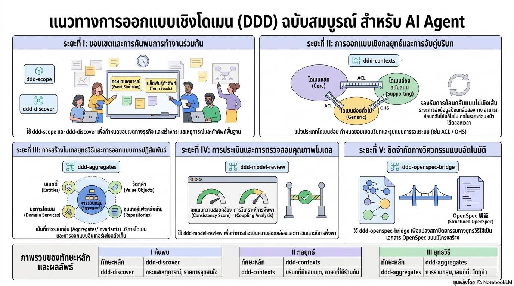

# แผนที่ภาพรวม DDD Skill (Domain-Driven Design)

> 🌐 English version: [English](README.en.md)

---

> ⚠️ **อยู่ระหว่างการพัฒนา (WIP)**: คลังข้อมูลนี้และระบบหลักที่พัฒนาขึ้นเองอยู่ระหว่างการก่อสร้างและปรับปรุงอย่างต่อเนื่อง โครงสร้าง เอกสาร และข้อกำหนดบางส่วนอาจเปลี่ยนแปลงได้ตลอดเวลา

คลังข้อมูลนี้ใช้ `ddd-*` Skill ที่พัฒนาขึ้นเองเป็นแกนหลัก ให้ชุดสายหลัก Domain Modeling สำหรับ AI Agent (ค้นพบ / เชิงกลยุทธ์ / เชิงยุทธวิธี / ตรวจสอบ / เชื่อมต่อข้อกำหนด) นอกจากนี้ยังรวบรวมบันทึกการวิจัย Skill DDD ที่เกี่ยวข้องจาก AI หลักในระบบนิเวศ (ดู[อ้างอิงระบบนิเวศภายนอก](#อ้างอิงระบบนิเวศภายนอก)) เพื่อเปรียบเทียบและอ้างอิงตามต้องการ

```sh
# Clone อย่างรวดเร็ว (รวม submodule ทั้งหมด)
git clone --recurse-submodules https://github.com/<your-org>/domain-driven-design-skills.git
```

---

## DDD Skills ของคลังข้อมูลนี้ (`ddd-*` Skill)

ผลงานหลักของคลังข้อมูลนี้คือกลุ่ม **`ddd-*` Skill ที่พัฒนาขึ้นเอง** ในไดเรกทอรี `skills/` ซึ่งประกอบเป็นสายหลัก Domain Modeling สำหรับ AI Agent Skill จากระบบนิเวศภายนอกเป็นเพียง **อ้างอิงระบบนิเวศ** (ดู[อ้างอิงระบบนิเวศภายนอก](#อ้างอิงระบบนิเวศภายนอก)) ใช้เปรียบเทียบและอ้างอิงตามต้องการ ไม่รับผิดชอบกระบวนการหลัก

### วัตถุประสงค์การออกแบบและขอบเขต

**ปัญหาที่ต้องแก้ไข**:

- DDD Skill ในระบบนิเวศ open source ส่วนใหญ่เป็น **ความสามารถจุดเดี่ยว** (เช่น ทำเฉพาะ Event Storming, ทำเฉพาะการสร้างโค้ด Aggregate) ขาดสายหลักที่สมบูรณ์และสามารถย้อนกลับได้จากการค้นพบ Problem Space → การแบ่งเชิงกลยุทธ์ → การ Model เชิงยุทธวิธี → การตรวจสอบโมเดล
- รูปแบบ Input/Output ของ Skill ต่างๆ ไม่เป็นมาตรฐาน AI Agent จึงเชื่อมต่อเป็นผลงานที่ส่งมอบได้ยาก
- กระบวนการ Modeling โดยเนื้อแท้เป็น **แบบไม่เป็นเส้นตรง** แต่ Skill ส่วนใหญ่ไม่มีเงื่อนไขการย้อนกลับที่ชัดเจน เมื่อพบปัญหาในภายหลังไม่สามารถระบุได้ว่าควรแก้ไขขั้นตอน upstream ตรงไหน

**เป้าหมาย**:

- ให้ Skill มาตรฐานที่ครอบคลุม 5 ขั้นตอน (ค้นพบ / เชิงกลยุทธ์ / เชิงยุทธวิธี / ตรวจสอบ / เชื่อมต่อข้อกำหนด) แต่ละ Skill สร้าง **ผลงานเชิงโครงสร้าง** ในการสนทนา 1 รอบ
- สร้างมาตรฐาน SKILL.md Interface Contract (เวลาที่ควรใช้, Input, ขั้นตอน, Output, รายการตรวจสอบ, เงื่อนไขย้อนกลับ) รับประกันว่าผลงานระหว่างขั้นตอนเชื่อมต่อกันได้
- นิยาม **เงื่อนไขย้อนกลับอย่างชัดเจน** (เช่น อัตราการแสดง Invariant < 60% กลับไป `ddd-aggregates`) สนับสนุนปิดลูป feedback สองทาง
- สนับสนุน **การเข้าแบบไม่เป็นลำดับ**: โครงการใหม่, ระบบมีอยู่, การ深化เฉพาะจุด, การตรวจสอบคุณภาพ, การสร้างข้อกำหนด สามารถค้นหา Skill ที่เหมาะสมได้

**ไม่ใช่เป้าหมาย**:

- **ไม่สร้างโค้ดธุรกิจโดยตรง** คลังข้อมูลนี้มุ่งเน้นการเชื่อมต่อ Domain Modeling กับข้อกำหนดทางวิศวกรรม (OpenSpec) การ implement โค้ดทำโดยนักพัฒนาหรือ AI จอห์น downstream
- **ไม่กำหนด Technology Stack เฉพาะ** (Java / Kotlin / Python / .NET ใช้ Skill จากระบบนิเวศภายนอก)

### รายการ Skill (5 ขั้นตอน / 9 Skills)

| ขั้นตอน    | Skill                     | คำอธิบายสั้น                                                        | การเพิ่มเติม (ภายนอก)                             |
| :---------- | :------------------------ | :------------------------------------------------------------------- | :------------------------------------------------- |
| I ค้นพบ     | `ddd-scope`               | การเล็ง Scope: ปัญหาStatements, เป้าหมาย/ไม่ใช่เป้าหมาย, ข้อจำกัด, ศัพท์บัญชี, รายการความเสี่ยง | `ddd-strategic-design`, `ddd-planning`             |
| I ค้นพบ     | `ddd-discover`            | การค้นพบ Domain แบบร่วมมือ: Event Stream, คำสั่ง/Event ที่เป็นไปได้, จุดร้อน และรายการจุดคลุมเครือ |                                                    |
| II เชิงกลยุทธ์ | `ddd-subdomains`          | การจำแนก Subdomain: Core/Supporting/Generic + คำประกาศ Domain หลักและข้อเสนอแนะความเป็นเจ้าของ | `ddd-context-mapping`, `domain-driven-design`      |
| II เชิงกลยุทธ์ | `ddd-contexts`            | การออกแบบ Bounded Context: หน้าที่, คลังคำศัพท์ภาษากลาง, Boundary ADR, ความเป็นเจ้าของ |                                                    |
| II เชิงกลยุทธ์ | `ddd-context-map`         | แผนที่ Context: รูปแบบการเชื่อมต่อ (ACL/OHS/PL ฯลฯ), ความเป็นเจ้าของสัญญา, รูปแบบความล้มเหลว |                                                    |
| III เชิงยุทธวิธี | `ddd-aggregates`          | การออกแบบ Aggregate: Invariant, Entity/Value Object, ขอบเขตธุรกรรม และกลยุทธ์ความสอดคล้องข้าม Aggregate | `domain-driven-design`, `clean-ddd-hexagonal`     |
| III เชิงยุทธวิธี | `ddd-domain-interactions` | Domain Interaction: สารบัญ Domain Event, Domain Service, Interface Repository, Factory |                                                    |
| IV ตรวจสอบ  | `ddd-model-review`        | การประเมินคุณภาพโมเดล: คะแนนความสอดคล้อง, การตรวจสอบความสมบูรณ์, การวิเคราะห์การเชื่อมต่อ และการย้อนกลับ | `clean-architecture`                               |
| V ข้อกำหนด  | `ddd-openspec-bridge`     | การเชื่อมต่อข้อกำหนด: แปลงผลงานเชิงยุทธวิธีของ DDD เป็นข้อกำหนดเชิงโครงสร้าง OpenSpec | `openspec-assistant`                               |

> **กระบวนการไม่เป็นเส้นตรง**: ระหว่างขั้นตอนรองรับ feedback สองทาง การตรวจสอบโมเดล (ขั้นตอน IV) สามารถ trigger ย้อนกลับไปขั้นตอนก่อนหน้าเพื่อแก้ไข ในที่สุดส่งออกเป็นข้อกำหนดทางวิศวกรรมผ่านขั้นตอน V แผนภาพการพึ่งพาและเมทริกซ์ย้อนกลับดูรายละเอียดที่ [ddd-skill-system-design.md](docs/ddd-skill-system-design.md) ภาคผนวก B



### การเลือกจุดเริ่มต้นและวิธีเรียกใช้

**เลือกจุดเริ่มต้นตามสถานการณ์**:

| สถานการณ์                    | จุดเริ่มต้นที่แนะนำ                       | คำอธิบาย                                     |
| :---------------------------- | :----------------------------------------- | :------------------------------------------- |
| โครงการใหม่, ความต้องการคลุมเครือ | `ddd-scope` → `ddd-discover` → …           | เริ่มจากการเล็ง Scope เดินจนครบ 5 ขั้นตอน   |
| ความต้องการชัดเจนแล้ว ต้องการสำรวจ | `ddd-discover`                             | มี scope context อยู่แล้ว ข้ามการเล็ง Scope |
| Subdomain ทราบแล้ว ต้องการปรับแต่งขอบเขต | `ddd-contexts`                             | ออกแบบ Context และภาษากลางจากการจำแนก Subdomain ที่มีอยู่ |
| ต้องการ深化 Tactics ใน Context เดียว | `ddd-aggregates`                           | มีนิยาม Context แล้ว มุ่งเน้น Aggregate และ Domain Interaction |
| มีโมเดลอยู่แล้วต้องการตรวจสอบ | `ddd-model-review`                         | ประเมินความสอดคล้อง ความสมบูรณ์ และการเชื่อมต่อของผลงาน Modeling ที่มีอยู่ |
| พร้อมพัฒนา สร้างข้อกำหนด   | `ddd-openspec-bridge`                      | แปลงโมเดลเชิงยุทธวิธีเป็น OpenSpec Change Set |

**วิธีเรียกใช้**: ในบทสนทนา AI Agent ใช้ไวยากรณ์ `@skill-name` ผลงานสามารถส่งเป็น Input ของ Skill ขั้นตอนถัดไปได้โดยตรง:

---

## อ้างอิงระบบนิเวศภายนอก

ตารางต่อไปนี้สรุปบันทึกการวิจัย Skill ที่เกี่ยวข้องกับ DDD จากชุมชน open source เพื่อ **ทำความเข้าใจสถานะปัจจุบัน เปรียบเทียบความแตกต่าง และ การผสมผสาน ตามต้องการ** พวกเขา **ไม่ใช่ส่วนหนึ่งของสายหลักคลังข้อมูลนี้** ใช้เป็นเพียงอ้างอิง ไม่ได้แจกจ่ายพร้อมกับคลังข้อมูลนี้

| ระดับการออกแบบ | ชื่อ Skill                  | เส้นทางที่มา                              | คลังข้อมูลต้นฉบับ                                                                       | สถานการณ์ที่เหมาะสม                                                  |
| :--------------- | :--------------------------- | :----------------------------------------- | :---------------------------------------------------------------------------------------- | :-------------------------------------------------------------------- |
| การ Model เชิงยุทธวิธีทั่วไป | `domain-driven-design`       | `relative-skills/wondelai-skills`          | [wondelai/skills](https://github.com/wondelai/skills)                                    | เครื่องมือ Model เชิงยุทธวิธีทั่วไป มุ่งเน้น Entity, Value Object, Aggregate, Domain Service, Repository ฯลฯ |
| การหลอมรวมรูปแบบสถาปัตยกรรม | `clean-ddd-hexagonal`        | `relative-skills/robust-skills`            | [ccheney/robust-skills](https://github.com/ccheney/robust-skills)                        | DDD + Clean Architecture + Hexagonal Architecture หลอมรวม ให้ Decision Tree กฎการพึ่งพา |
| การออกแบบเชิงกลยุทธ์   | `ddd-strategic-design`       | `relative-skills/antigravity-awesome-skills` | [sickn33/antigravity-awesome-skills](https://github.com/sickn33/antigravity-awesome-skills) | Bounded Context, Subdomain, Ubiquitous Language, Context Mapping การออกแบบเชิงกลยุทธ์ |
| การออกแบบเชิงกลยุทธ์   | `ddd-context-mapping`        | `relative-skills/antigravity-awesome-skills` | [sickn33/antigravity-awesome-skills](https://github.com/sickn33/antigravity-awesome-skills) | การเชื่อมต่อระหว่าง Bounded Context, Anti-Corruption Layer, Open Host Service ฯลฯ |
| การออกแบบเชิงกลยุทธ์   | `architecture-patterns`      | `relative-skills/antigravity-awesome-skills` | [sickn33/antigravity-awesome-skills](https://github.com/sickn33/antigravity-awesome-skills) | ชุดรูปแบบสถาปัตยกรรมครบวงจรที่ครอบคลุม Clean Architecture, Hexagonal Architecture และ DDD |
| เชี่ยวชาญ Technology Stack | `arch-ddd`                   | `relative-skills/aiee-team`                | [ai-enhanced-engineer/aiee-team](https://github.com/ai-enhanced-engineer/aiee-team)      | DDD Architect ภาษา Python แนะนำ Domain Model, Repository Pattern, Unit of Work ฯลฯ |
| เชี่ยวชาญ Technology Stack | `ddd-planning`               | `relative-skills/claude-skill-registry`    | [majiayu000/claude-skill-registry](https://github.com/majiayu000/claude-skill-registry)  | DDD Planner ภาษา Kotlin รองรับ Event Storming และการสร้างโค้ด Kotlin |
| Framework/Platform เฉพาะ | `cleanddd-skills`            | `relative-skills/cleanddd-skills`          | [netcorepal/cleanddd-skills](https://github.com/netcorepal/cleanddd-skills)              | Clean DDD ชุด 4 ขั้นตอน: การวิเคราะห์ความต้องการ → Modeling → เริ่มต้นโครงการ → การ implement โค้ด |
| Framework/Platform เฉพาะ | `claude-flow`                | `relative-skills/agentic-flow`             | [ruvnet/agentic-flow](https://github.com/ruvnet/agentic-flow)                            | Claude Flow Kernel ใช้ DDD สร้างระบบ AI Agent แบบ modular |
| Framework/Platform เฉพาะ | `Solon AI Skills`            | `relative-skills/solon-ai`                 | [opensolon/solon-ai](https://github.com/opensolon/solon-ai)                              | Solon AI Framework มอง Skill เป็น Autonomous Semantic Context ได้รับแรงบันดาลใจจาก DDD |
| สถานการณ์/แอปพลิเคชันหลัก | `microservices-architect`    | `relative-skills/jeffallan-claude-skills`  | [Jeffallan/claude-skills](https://github.com/Jeffallan/claude-skills)                    | Microservices Architect ใช้ Bounded Context ของ DDD นำทางการแบ่งบริการ |

> วิธีอ้างอิง: รับจากลิงก์คลังข้อมูลต้นฉบับในตาราง เรียกใช้ตามข้อตกลงดั้งเดิมในแต่ละคลังข้อมูล (โดยทั่วไปคือ `@skill-name`)

**ข้อเสนอแนะการเลือก**:

| หากคุณต้องการ…                                     | Skill ที่แนะนำ                                                   |
| :-------------------------------------------------- | :--------------------------------------------------------------- |
| ช่วยเขียนโค้ดตาม DDD                               | **ประเภท Model เชิงยุทธวิธีทั่วไป** (`domain-driven-design`)   |
| ประเมินหรือ Refactor โค้ดที่มีอยู่ตาม DDD          | **ประเภท Model เชิงยุทธวิธีทั่วไป** (`domain-driven-design`)   |
| ออกแบบระบบใหม่ที่มีสถาปัตยกรรมชัดเจน              | **ประเภทหลอมรวมรูปแบบสถาปัตยกรรม** (`clean-ddd-hexagonal`)    |
| วางแผนหรือจัดระเบียบ Module และขอบเขต Microservices ของธุรกิจที่ซับซ้อน | **ประเภทการออกแบบเชิงกลยุทธ์** (`ddd-strategic-design`, `ddd-context-mapping`) |
| โครงการมี Technology Stack ที่ต้องการชัดเจน        | **ประเภทเชี่ยวชาญ Technology Stack** (`arch-ddd`, `ddd-planning`) |
| ค้นหากระบวนการ  DDD ที่มีมาตรฐานและเชิงโครงสร้างสำหรับทีม | **ประเภท Framework/Platform เฉพาะ** (`cleanddd-skills`)         |
| สร้างระบบ AI Agent ที่ซับซ้อน                       | **ประเภท Framework/Platform เฉพาะ** (`claude-flow`, `Solon AI Skills`) |

---

## การตรวจสอบคุณภาพ

เพื่อทำการ **ประเมินคุณภาพแบบObjectiveและทำซ้ำได้** สำหรับ `ddd-*` Skill ที่พัฒนาขึ้นเอง คลังข้อมูลดูแลไดเรกทอรี `validation-cases/` แยกต่างหาก รวบรวมกรณีตรวจสอบ blind-run end-to-end และวิธีตรวจสอบทั่วไป

- [validation-cases/README.md](validation-cases/README.md) — **สรุปวิธีตรวจสอบ**: กระบวนการ 6 ขั้นตอน (Input คลุมเครือ → blind-run 8 Skill → การดึง True Value → การให้คะแนนเทียบ  → การทดสอบ injection ย้อนกลับ → รายงานสรุป), ข้อจำกัด blind-run, เมทริกซ์ injection, ขั้นตอนที่ใช้ซ้ำได้ และข้อจำกัดที่รู้อยู่แล้ว
- [validation-cases/cargo-validation/](validation-cases/cargo-validation/) — **กรณีตรวจสอบ Cargo**: ใช้ DDD Sample การขนส่ง Cargo ของ Eric Evans + Citerus (submodule `validation-cases/cargo-shipping`) เป็น True Value อ้างอิง เดินสาย  Skill 8 ขั้นตอนครบถ้วน ปัจจุบันได้คะแนนถ่วงน้ำหนัก **85.8%** (B+ ดี), เครื่องมือย้อนกลับ **5/5 ผ่านทั้งหมด**; ข้อสรุปครบถ้วนดูที่ [REPORT.md](validation-cases/cargo-validation/REPORT.md)
- [validation-cases/insurance-validation/](validation-cases/insurance-validation/) — **กรณีตรวจสอบการรับประกันและการเคลมประกัน**: _DOMAIN ที่ไม่มีข้อกำหนดอ้างอิง_ (ประกันภัย) ใช้ระบบการตรวจสอบของผู้เชี่ยวชาญ (เกณฑ์ 4 ประเภทแทนจุดยึด True Value) ได้คะแนนถ่วงน้ำหนัก **90.9%** (เปรียบเทียบกับคะแนน Cargo โดยตรงไม่ได้); เพิ่มขั้นตอน V (`ddd-openspec-bridge`, การตรวจสอบ OpenSpec Change Set 9/9 ผ่าน) ทำให้ครบ 5 ขั้นตอน ข้อสรุปครบถ้วนดูที่ [REPORT.md](validation-cases/insurance-validation/REPORT.md)

ผลการตรวจสอบได้ กลับไปสู่การปรับปรุง Skill หลัก (เช่น "การตรวจสอบการอ้างอิงภายนอกอีกครั้ง + รูปแบบ Specification" ของ `ddd-aggregates`, "มิติเทียบ อุตสาหกรรม" ของ `ddd-model-review`, "ADR แนวคิดระหว่างทาง" ของ `ddd-contexts`) สร้างปิดลูป feedback ที่สังเกตได้

---

## โครงสร้างไดเรกทอรี

> บันทึกการวิจัย Skill จากภายนอกดูที่[อ้างอิงระบบนิเวศภายนอก](#อ้างอิงระบบนิเวศภายนอก) ไม่แจกจ่ายในรูปแบบ submodule อีกต่อไป

---

## เอกสารที่เกี่ยวข้อง

- [ddd-quickstart.md](docs/ddd-quickstart.md) — **เริ่มต้นอย่างรวดเร็ว**: Skill คืออะไร, รันที่ไหน, ทำอย่างไรจาก 0 ถึง 1 ให้เสร็จหนึ่งรอบ Modeling (ผู้เริ่มต้นต้องอ่าน)
- [ddd-skill-system-design.md](docs/ddd-skill-system-design.md) — เอกสารการออกแบบสายหลักระบบ DDD ที่พัฒนาขึ้นเอง (โมเดล 5 ขั้นตอน, แผนภาพการพึ่งพา, เมทริกซ์ปิดลูป feedback)
- [ddd-pipeline-article.md](docs/ddd-pipeline-article.md) — บทความแนะนำ  Skill แบบบรรยาย (สายหลัก 4 ขั้นตอน / 8 Skill เวอร์ชันแรก + ผลการตรวจสอบ Cargo สำคัญ)
- [ddd-openspec-mapping.md](docs/ddd-openspec-mapping.md) — คู่มือการจับคู่: นิยามมาตรฐานการแปลงผลงานเชิงยุทธวิธี DDD เป็นข้อกำหนด OpenSpec
- [ddd-skills-report.md](docs/ddd-skills-report.md) — รายงานการวิจัย Skill DDD (รวมการอ้างอิงและ Backlog การปรับปรุง)
- [validation-cases/README.md](validation-cases/README.md) — สรุปวิธีตรวจสอบ (กระบวนการ blind-run 6 ขั้นตอน, เมทริกซ์ injection, คู่มือการใช้ซ้ำ)
- [validation-cases/cargo-validation/REPORT.md](validation-cases/cargo-validation/REPORT.md) — รายงานผลการตรวจสอบ Cargo Shipping (คะแนนปัจจุบัน 85.8%)
- [validation-cases/insurance-validation/REPORT.md](validation-cases/insurance-validation/REPORT.md) — รายงานผลการตรวจสอบการรับประกันและการเคลมประกัน (ไม่มีข้อกำหนดอ้างอิง, ระบบตรวจสอบผู้เชี่ยวชาญ 90.9%)

---

## การจัดการ Submodule

คลังข้อมูลเก็บเฉพาะ `validation-cases/cargo-shipping` เป็น submodule เดียว (True Value สำหรับกรณีตรวจสอบ) หาก clone แล้วแต่ยังไม่ได้ดึงข้อมูล:

```sh
git submodule update --init --recursive
```