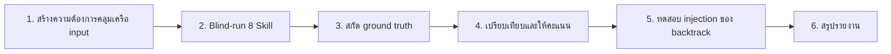

## Pipeline การสร้างแบบจำลอง DDD ที่ตรวจสอบได้: จากความต้องการคลุมเครือสู่ Aggregate Model ในรูปแบบวิศวกรรม

> 🌐 English version: [English](ddd-pipeline-article.en.md)

---

> หมายเหตุ: บทความนี้อธิบาย **pipeline design เวอร์ชันแรกของระบบ (4 stages / 8 Skill)** ซึ่งเป็นเวอร์ชันที่ตรงกับกรณีตรวจสอบ Cargo Shipping ในปัจจุบัน
> แกนหลักปัจจุบันได้ขยายเป็น **5 stages / 9 Skill** โดยเพิ่ม stage V `ddd-openspec-bridge` สำหรับแปลง tactical model เป็น OpenSpec engineering specification; ดูรายละเอียดที่ [ddd-skill-system-design.md](ddd-skill-system-design.md)

บทความนี้อธิบายระบบ DDD Skill แบบเป็น pipeline 8 Skill ใน 4 ขั้นตอน (ค้นพบ → เชิงกลยุทธ์ → เชิงยุทธวิธี → ตรวจสอบ) โดยใช้ SKILL.md สัญญา 7 หัวข้อเพื่อกำหนด input/output types, ใช้ 10 Backtrack Triggers แบบ numeric สำหรับ nonlinear feedback, และใช้ 6-step blind-run method เพื่อให้ baseline การให้คะแนนจากภายนอก ผลการตรวจสอบรอบแรกของ Cargo Shipping: weighted score 85.8%, Backtrack Triggers 5/5 ผ่านทั้งหมด

---

## บทนำ

Domain-Driven Design ถูกนำเสนอมาเกือบยี่สิบปีแล้ว แต่การนำไปใช้งานจริงยังคงพึ่งพาประสบการณ์และสัญชาตญาณของผู้สร้างแบบจำลองที่มีประสบการณ์สูงเพียงไม่กี่คน Eric Evans ได้สร้างกรอบเชิงกลยุทธ์และเชิงยุทธวิธีขึ้นในปี 2003 Alberto Brandolini ใช้ Event Storming ทำให้การสร้างแบบจำลองแบบร่วมมือกันเข้าสู่ workshop ได้ และ Vaughn Vernon ได้เขียนคู่มือการนำไปใช้งานเพื่อให้ Aggregate และ Bounded Context มีคู่มือปฏิบัติ—แต่ปัญหา "คนคนเดียวไม่สามารถนำ workshop ทั้งหมดไปด้วยได้" ไม่เคยได้รับการแก้ไขอย่างแท้จริง เมื่อผู้สร้างแบบจำลองจากไป แบบจำลองก็หยุดวิวัฒนาการ

บทความนี้ใช้การทดลองแบบ open source ตัวอย่าง—"DDD Skill Aggregate Repository" เป็นตัวอย่าง เพื่ออธิบายวิธีการแบ่ง domain modeling ออกเป็น 8 Skill ที่มีขอบเขตชัดเจน สามารถต่อเนื่องกันได้ ย้อนกลับได้ และสามารถให้คะแนนได้ด้วยกรณีจริง โดยกรณีตรวจสอบ Cargo Shipping ได้ผล weighted score 85.8% และ Backtrack Triggers 5/5 ผ่านทั้งหมด ทำให้คำถามเก่าที่ว่า "การสร้างแบบจำลองสามารถเป็นวิศวกรรมได้หรือไม่" ถูกผลักกลับไปสู่พื้นที่ทำงานที่สามารถวัดผลได้อีกครั้ง

หากคุณกำลังลังเลว่า "จะให้ AI ช่วยทีมทำ DDD หรือไม่" บทความนี้ไม่ได้นำเสนอคำมั่นสัญญา แต่นำเสนอตัวเลขและวิธีการตรวจสอบที่สามารถทำซ้ำได้

---

## 1. พื้นหลัง: ความบรรจบกันของ DDD และ AI Agent

"Domain-Driven Design" และ "AI Agent Skill" ต่างเติบโตเต็มที่ในยุคที่ต่างกัน แต่เกิดปฏิกิริยาในช่วงเวลาที่บรรจบกันระหว่างปี 2024-2026 ฝั่งหนึ่งคือสถานะที่มั่นคงของ methodology—ทฤษฎีไม่มีข้อถกเถียงสำคัญแล้ว แต่การปฏิบัติยังพึ่งพาคนมาก อีกฝั่งคือ paradigm ทางวิศวกรรมของรูปแบบ Skill—การบรรจุความสามารถเชิงอะตอมให้เป็นหน่วยที่ compose ได้ เรียกใช้ได้ สองแรงนี้ปะทะกันเกิดเป็นความต้องการหลัก: ทำให้เส้นทางการคิดสร้างแบบจำลองที่ซ่อนอยู่กลายเป็น Skill contract ที่แสดงออกชัดเจน

### 1.1 สถานะที่มั่นคงของ DDD Methodology

โครงสร้างความรู้ของ DDD มีความมั่นคงค่อนข้างมากแล้ว ในระดับเชิงกลยุทธ์ Bounded Context และ Ubiquitous Language สร้างโครงร่างมหภาค Context Map กำหนด topology ของความร่วมมือระหว่าง contexts ในระดับเชิงยุทธวิธี Aggregate, Entity, Value Object, Domain Event เป็นชิ้นส่วนจุลภาค จาก Blue Book ของ Evans ถึง Red Book ของ Vernon จาก Starter Modelling Process ของ ddd-crew ถึง Event Storming practices ของชุมชน ความหมายของ core pattern ได้แข็งตัวสูงมากแล้ว

อย่างไรก็ตาม การแข็งตัวของ methodology ไม่ได้นำมาซึ่งความสอดคล้องในการส่งมอบ Event Storming ผลลัพธ์ยังคงค้างอยู่บน sticky note การตัดสินใจการออกแบบ aggregate ยังคงอยู่ในหัวของสถาปนิก Ubiquitous Language เขียนลง Wiki แล้วไม่มีใครดูแลอีก **Methodology ถูกใช้บ่อยมากในทางปาก แต่ยากที่จะตกผลึกเป็น artifact ที่สามารถทำซ้ำได้และเครื่องสามารถ Parse ได้**

### 1.2 Paradigm ทางวิศวกรรมของ AI Agent Skill

รูปแบบ Skill ของ AI Agent มอบตัวกลางใหม่ทั้งหมด Skill = Markdown prompt ที่มี YAML metadata + Input/Output/Process/Checklist ที่ชัดเจน มันไม่ใช่ model แบบ black box แต่เป็น "cognitive contract" ที่มีโครงสร้าง—บอก Agent ว่าจะเริ่มต้นเมื่อใด ดำเนินการตามขั้นตอนใด ใช้รูปแบบ output ใด และตัดสินว่าเสร็จสิ้นหรือต้องย้อนกลับเมื่อใด

รูปแบบการเรียก `@skill-name` เหมาะสมกับ DDD modeling โดยธรรมชาติ: ปัญหาธุรกิจเดียวกันต้องการการให้เหตุผลเฉพาะทางหลายรอบ—ค้นพบขอบเขต domain ก่อน แล้วจึงแบ่ง contexts จากนั้นออกแบบ internal structure ของ aggregate—นี่คืองานที่หลาย Skill ต่อเนื่องกันทำ

### 1.3 จุดบรรจบ

Methodology และรูปแบบ Skill ดังกล่าวข้างต้นนำเสนอความต้องการหลักที่จุดบรรจบ: **ทำให้เส้นทางการคิดที่ซ่อนอยู่ของผู้สร้างแบบจำลองที่มีประสบการณ์ ตกผลึกเป็น Skill contract ที่แสดงออกชัดเจน ทำให้วิศวกรที่มีประสบการณ์ระดับกลาง (หรือ AI Agent) ก็สามารถสร้าง domain model ที่ได้ 80 คะแนนขึ้นไปได้**

นี่ไม่ใช่การแทนที่ผู้เชี่ยวชาญ แต่เป็นการเข้ารหัส decision framework ของผู้เชี่ยวชาญให้เป็นขั้นตอนที่ทำซ้ำได้ ทำให้ทีมไม่ต้องสร้างแบบจำลองไม่ได้เพราะ "ไม่มีคนคนนั้น"

---

## 2. ปัญหา: ทำไม DDD Skill ecosystem ที่มีอยู่ยัง "ไม่น่าเชื่อถือ"

ความต้องการที่จุดบรรจบล้วนน่าดึงดูดมาก แต่จุดอ่อนเชิงโครงสร้าง 3 ข้อของ ecosystem ที่มีอยู่— fragmentation, ไม่มีสัญญา, ไม่มีการตรวจสอบ—ทำให้ "AI ช่วย DDD modeling" ยังคงอยู่ในขั้น demo มาเป็นเวลานาน ผู้นำทางเทคนิคคนใดที่ประเมินอย่างจริงจังล้วนถามว่า: **ผมจะเชื่อถือผลลัพธ์ของ Skill เหล่านี้ได้อย่างไร?**

### 2.1 Fragmentation: 20+ External Skill ทำตามใจชอบ

ชุมชน open source มี DDD Skill จำนวนมากเกิดขึ้นแล้ว antigravity-awesome-skills มี `ddd-strategic-design` และ `ddd-context-mapping` claude-skill-registry มี `ddd-planning` wondelai-skills มี `domain-driven-design` ทั่วไป cleanddd-skills มี 4-stage workflow สำหรับ .NET platform aiee-team มุ่งเน้น Python ecosystem ของ `arch-ddd`

ปัญหาไม่ใช่ "น้อยเกินไป" แต่ "แตกเกินไป" Skill เหล่านี้ต่างกำหนด naming convention, stage division, deliverable format เป็นของตัวเอง บ้างทำเฉพาะเชิงกลยุทธ์ บ้างกระโดดไป code generation โดยตรง บ้างผสม Event Storming และ aggregate design เข้าด้วยกันในขั้นตอนเดียว ผลลัพธ์คือ **ช่องว่างในการครอบคลุม stages, ความซ้ำซ้อนของ concepts, ไม่สามารถ assemble เป็น end-to-end pipeline ได้** output "Event Storming" ของ repo A ไม่สามารถส่งต่อโดยตรงให้ "aggregate design" ของ repo B ได้—เพราะพวกเขาไม่ได้พูดภาษาเดียวกัน

### 2.2 ไม่มีสัญญา: Skill output drift แบบสุ่ม

การไม่มี interface constraint แบบหมายความว่า Skill เดียวกันให้ granularity, fields, levels ที่ไม่เสถียรในแต่ละ session ครั้งแรกให้ตาราง 6 columns ครั้งที่สองกลายเป็นข้อความ 3 ย่อหน้า สำหรับ downstream consumer—ไม่ว่าจะเป็นคนหรือ Agent—ล้วนเป็นหายนะ

**Skill ถัดไปไม่สามารถคาดเดาได้ว่า Skill ก่อนหน้าจะให้อะไร** ถ้า `ddd-aggregates` ไม่รู้ว่า `ddd-contexts` จะ output "context directory" table ที่มีรูปแบบตายตัว มันก็ต้องเดาโครงสร้าง input ใหม่ทุกครั้งที่ดำเนินการ ความไม่แน่นอนนี้ขยายใหญ่ขึ้นใน pipeline หลายขั้น ทำให้ทั้งสายไม่น่าเชื่อถือในที่สุด

### 2.3 ไม่มีการตรวจสอบ: ไม่มี ground truth, ไม่มี scoring, ไม่มี backtracking

ในอุตสาหกรรมแทบไม่มีกรณีที่เปิดเผยเรื่อง "นำ DDD Skill ตัวหนึ่งไป blind-run กับตัวอย่างคลาสสิกแล้วให้คะแนน" การปรับปรุงทั้งหมดbased on intuition: "Skill นี้รู้สึกว่า output ไม่ค่อยถูก ข้าจะปรับ prompt หน่อย"—ไม่มี baseline ไม่มี measurement ไม่มีหลักฐาน

ไม่มี scoring ก็ไม่มี feedback loop **Skill ไม่สามารถ iterate ตามหลักฐานได้ การเปลี่ยนแปลงทั้งหมดพึ่งgut feeling** แย่ยิ่งกว่า เมื่อกระบวนการสร้างแบบจำลองมีปัญหา ไม่มีกลไกใดบอกคุณว่า "ควรย้อนกลับไปที่ขั้นตอนไหนเพื่อแก้ไข" ทั้งสายเป็นทางเดียว ไม่สามารถย้อนกลับได้—ซึ่งขัดแย้งกับกระบวนการสร้างแบบจำลอง domain จริง (nonlinear, ต้องแก้ไขซ้ำแล้วซ้ำเล่า) อย่างมีนัยสำคัญ

---

## 3. แนวทาง: three-in-one ของ 8 Skill × 4 ขั้นตอน × วิธีตรวจสอบ

สำหรับ 3 shortcomings นี้ DDD Skill Aggregate Repository ให้คำตอบแบบ three-in-one: **ข้อแรก ทำให้ชิ้นส่วนมีโครงสร้างผ่าน 4 stages pipeline; ข้อที่สอง ทำให้ output มีสัญญาผ่าน SKILL.md contract; ข้อที่สาม ทำให้ iteration มีหลักฐานผ่าน blind-run verification** บทความนี้จะเรียงตามลำดับ โครงสร้าง → สัญญา → feedback → verification → evidence

สำหรับรายละเอียดการออกแบบclosed-loopของ stages และ skill mapping กรุณาดูเอกสารออกแบบอิสระ: [ddd-skill-system-design.md](ddd-skill-system-design.md)

### 3.1 โครงร่าง: 4-Stage Linear Main Path

ต้นตอของปัญหา fragmentation คือการขาด main path ที่ได้รับการยอมรับ แกนหลักของระบบใช้ 4 ขั้นตอน ซึ่งเป็นตัวแทนของ 4 ประเภทงานสร้างแบบจำลองที่แตกต่างกัน—จากการสำรวจแบบกระจายไปสู่การออกแบบที่แม่นยำไปจนถึงการตรวจสอบเชิงวิพากษ์:

| ขั้นตอน | Skill | โหมดการรับรู้ | คำสำคัญของ output |
| -------- | ----- | -------------- | ------------------- |
| I ค้นพบ | `ddd-scope`, `ddd-discover` | การกระจายการสำรวจ | ขอบเขตการสร้างแบบจำลอง, flow หลัก, ต้นแบบเหตุการณ์ |
| II เชิงกลยุทธ์ | `ddd-subdomains`, `ddd-contexts`, `ddd-context-map` | การวิเคราะห์และแบ่งส่วน | การจัดระดับ subdomains, bounded contexts, ความสัมพันธ์การ integrate |
| III เชิงยุทธวิธี | `ddd-aggregates`, `ddd-domain-interactions` | การออกแบบแม่นยำ | Aggregates, domain events, interfaces ของ repositories/factories |
| IV ตรวจสอบ | `ddd-model-review` | การตรวจสอบเชิงวิพากษ์ | คะแนนคุณภาพ, สัญญาณ backtrack |

8 Skill ครอบคลุม chain การรับรู้ทั้งหมดจาก "เรากำลังแก้ปัญหาอะไร" ไปจนถึง "แบบจำลองสอดคล้องกัน สมบูรณ์ และนำไปใช้ได้จริงหรือไม่" Skill แต่ละตัวผลิต artifact ที่มีโครงสร้างในหนึ่งรอบบทสนทนา และ artifact ไหลเข้าสู่ input ของ downstream Skill โดยตรง—เชื่อมต่อกันได้เหมือน standard parts บนสายพาน

ความเข้าใจสำคัญ: main path ไม่ใช่ "waterfall" มันให้ลำดับการดำเนินการที่แนะนำ แต่ระบบรองรับ 5 non-sequential entry points—ถ้ามี requirements อยู่แล้วสามารถเริ่มจาก `ddd-discover` เริ่มต้น ถ้ารู้ subdomains แล้วสามารถเข้าสู่ `ddd-contexts` โดยตรง ถ้ามีแบบจำลองอยู่แล้วสามารถใช้ `ddd-model-review` ตรวจสอบ โครงร่างไม่ใช่กรง แต่เป็นถนนหลักของทางด่วน

### 3.2 สัญญา: SKILL.md Interface Specification

การเชื่อมต่อ Skill แต่ละตัวบน main path เข้ากับ interface contract ชุดเดียวกัน ทำให้พวกเขาสามารถเรียกใช้กันได้จริง สัญญาบังคับโครงสร้าง 7 หัวข้อ แต่ละหัวข้อมีขอบเขตความรับผิดชอบที่ชัดเจน:

1. **YAML Frontmatter**—name, description, risk, source, tags, date_added ทำให้เครื่องสามารถ discover และ index ได้
2. **เวลาที่จะใช้**—จะเรียกใช้เมื่อใด prerequisites คืออะไร ป้องกันการ trigger ผิด
3. **ข้อกำหนด Input**—upstream ต้องให้อะไรบ้าง (ระบุ source Skill) มี optional inputs อะไรบ้าง
4. **ขั้นตอน**—5-7 ขั้นตอนการดำเนินการ Agent ดำเนินการตามลำดับ
5. **Output**—ผลลัพธ์แบบตาราง columns ตายตัว downstream สามารถใช้ได้โดยตรง
6. **Checklist ตรวจสอบ**—exit gate ของ Skill นี้ ทุกข้อต้องผ่านก่อนจึงจะส่งมอบได้
7. **Backtrack Trigger**—เงื่อนไขและ threshold ที่จะกลับไป upstream Skill

สัญญานี้แก้ปัญหา "output drift" ยกตัวอย่าง `ddd-aggregates` output ถูกกำหนดเป็น 6 ตาราง: aggregate directory, invariant table, entity & value object list, transaction boundary description, cross-aggregate consistency strategy, repository interface draft ชื่อ columns, ความหมาย, และข้อกำหนดโครงสร้างของแต่ละตารางเขียนไว้ในสัญญา **input และ output เขียนเป็น type**—Agent ถึงจะ assemble กันได้ เหมือน function ที่ส่ง parameter แบบ strongly typed แทน random string

### 3.3 .feedback: Nonlinear Backtrack Triggers

หัวข้อ **Backtrack Trigger** ในสัญญาไม่ใช่ของตกแต่ง แต่เป็นกลไกหลักที่ทำให้ระบบนี้แตกต่างจาก linear pipeline การสร้างแบบจำลองจริงไม่เคยผ่านในครั้งเดียว: ออกแบบ aggregate เสร็จแล้วพบว่าแบ่ง context boundary ผิด เขียน event catalog เสร็จแล้วพบว่า terminology conflict แก้ไม่ได้

ระบบกำหนดกฎ backtrack ที่มีโครงสร้าง 10 ข้อ ครอบคลุม feedback ทั้งสายจาก stage IV กลับไป stage I 5 ข้อหลักที่สำคัญที่สุด:

| เงื่อนไข trigger | เป้าหมาย backtrack | คำอธิบาย |
| ------------------- | -------------------- | ---------- |
| invariant expression ratio < 60% | `ddd-aggregates` | Aggregate อาจเป็น data container แทน behavioral boundary |
| terminology conflict ratio > 20% | `ddd-contexts` | Ubiquitous Language นิยามไม่เพียงพอ |
| event completeness < 70% | `ddd-domain-interactions` | Event catalog ขาด critical flows |
| aggregate boundary ขัดแย้งกับ context boundary | `ddd-contexts` | Context ต้องแบ่งใหม่เพื่อรองรับ consistency requirements |
| integration pattern ไม่สอดคล้องกับ context map | `ddd-context-map` | เชิงยุทธวิธีค้นพบ integration requirements ใหม่ |

ค่าของ trigger อยู่ที่ **การแปลง "judgment ตามประสบการณ์" เป็น "numerical threshold"** เมื่อ `ddd-model-review` คำนวณว่ามิติใดมิติหนึ่งต่ำกว่า threshold มันไม่ต้องขออนุมัติจากผู้เชี่ยวชาญก็ตัดสินใจย้อนกลับไปที่ Skill ใดเพื่อดำเนินการใหม่ ในขณะเดียวกัน เพื่อป้องกัน infinite loop ระบบกำหนดว่า backtrack path เดียวกันทำได้สูงสุด 3 ครั้ง—ถ้าครั้งที่ 3 ยัง trigger อยู่ จะทำเครื่องหมายว่า "ต้องการ human intervention"

กลไกนี้ทำให้ Agent สามารถเลือกความลึกในการย้อนกลับได้ด้วยตัวเองเมื่อไม่มีผู้เชี่ยวชาญ—มันไม่ใช่ "เริ่มใหม่จากต้น" อย่างง่ายๆ แต่ระบุระดับที่มีปัญหาได้อย่างแม่นยำ

### 3.4 การตรวจสอบ: 6-Step Blind-Run Method

Trigger มีแล้ว แต่ยังต้องการไม้บรรทัดจากภายนอกเพื่อตัดสินว่า Skill combination ผ่านมาตรฐานจริงหรือไม่ checklist ตรวจสอบของ Skill เองไม่สามารถพิสูจน์ประสิทธิภาพของทั้งสายได้—คุณต้องการ ground truth source ที่เป็นอิสจาจากระบบ

วิธีตรวจสอบถูกปรับเปลี่ยนเป็น 6-step closed-loop:

**ขั้นตอนที่ 1: สร้างความต้องการคลุมเครือ input** จาก reference implementation เขียน business brief ความยาว 500-800 คำ—มีเพียง business scenarios, roles, goals, constraints โดยลบ DDD terms และ class names ของ reference implementation ทั้งหมดออก ทำให้มั่นใจว่า Skill ดำเนินการในเงื่อนไขที่ "ไม่รู้คำตอบจริงๆ"

**ขั้นตอนที่ 2: Blind-run 8 Skill** ดำเนินการตามลำดับ 4 stages อย่างเคร่งครัด แต่ละขั้นตอนอ่านเฉพาะ upstream output ที่ Skill ปัจจุบันกำหนด วินัย blind-run ห้ามอ้างอิง ground truth files ระหว่างดำเนินการ—เฉพาะหลังจาก Skill ทั้ง 8 ตัว output เสร็จแล้วเท่านั้นจึงเข้าสู่ขั้นตอน scoring

**ขั้นตอนที่ 3: สกัด ground truth** สกัด ground truth 4 ประเภทจาก source code, architecture docs, test cases ของ reference implementation อย่างอิสระ—contexts, aggregates, events, integration mapping—and ใส่ใน directory `reference/` Ground truth กับ blind output แยกจากกันอย่างสมบูรณ์

**ขั้นตอนที่ 4: เปรียบเทียบและให้คะแนน** จัด weight 1.0-2.0 ตามอิทธิพล ของ Skill (รวม 11.0) ใช้มาตรฐาน 5 ระดับ 0-4 scoring specification ประกอบด้วย "class A anchors" (key concepts ที่ต้อง hit) และ "class B adjustments" (positive outliers / anti-patterns) ทำให้คะแนนตรวจสอบซ้ำได้ ทำซ้ำได้

**ขั้นตอนที่ 5: ทดสอบ injection ของ backtrack** ฉีด defects ที่ควบคุมได้เข้าไปใน blind output (เช่น ลบ invariant ส่วนใหญ่ ให้ read-only aggregate รับผิดชอบ business decisions) จากนั้นรัน `ddd-model-review` ใหม่ ตรวจสอบว่า triggers ถูก activated อย่างถูกต้องและ routing ไปยังเป้าหมายที่คาดไว้

**ขั้นตอนที่ 6: สรุปรายงาน** ผลลัพธ์เป็นรายงานสุดท้ายที่มี 8 sections: executive summary, verification scope, scoring overview, backtrack test results, key findings, improvement suggestions, artifact catalog, conclusion

3 constraints สำคัญทำให้วิธีนี้น่าเชื่อถือ: วินัย blind-run รับประกันความเป็นกลางในการประเมิน; ground truth ที่สกัดอย่างอิสารับประกันความน่าเชื่อถือของ baseline; injection test รับประกันว่า feedback loop ทำงานได้จริง

### 3.5 หลักฐานจริง: กรณี Cargo Shipping

โครงร่าง-สัญญา-feedback-verification ชุดสี่อย่างจะไร้ค่าถ้าหยุดอยู่บนกระดาษ ต่างจาก "ecosystem ที่มีอยู่" ที่มันวิพากษ์ ต้องใช้กรณีจริงรันหนึ่งรอบและเปิดเผยตัวเลข ถึงจะมีความน่าเชื่อถือ

ใช้ Cargo Shipping DDD Sample ที่ Eric Evans และ Citerus ดูแลร่วมกันเป็นเป้าหมาย ดำเนินการตรวจสอบครบทั้งรอบเป็นครั้งแรก กรณี Cargo ถูกเลือกเพราะเป็น "classic reference" ที่ชุมชน DDD ยอมรับ—มี domain model ที่สุกงอม มี open source code มี architecture docs ที่ชัดเจน สามารถให้ ground truth คุณภาพสูง

**ผลลัพธ์หลัก:**

- **Weighted total score 85.8% (B+ ดี)**—ครอบคลุม evaluation dimensions ทั้งหมดของ 8 Skill Stage ที่แข็งแกร่งที่สุดคือ discovery (Stage I) และ domain interactions (Stage III-b) ทั้งคู่ได้ 4.0/4 เต็ม อ่อนที่สุดคือ aggregate design และ model review (ทั้งคู่ 2.5/4) คำตอบข้อแรก: ลด Voyage แล้ว Location แล้ว Specification pattern, คำตอบข้อที่สอง: concept overlap แล้ว future domain gaps

- **Backtrack Triggers 5/5 ผ่านทั้งหมด**—inject 5 defects ที่ควบคุมได้: เหลือ invariant 4/11 (36%), ให้ TrackingView รับผิดชอบ misdelivery judgment, ลบ 4 key derived events (completeness 64%), ชื่อ shipment three naming conventions mixed (22.2%), domain service bypass ACL เชื่อมต่อภายนอกโดยตรง ทั้ง 5 triggers ถูก activated อย่างถูกต้อง วินิจฉัยแม่นยำ routing ถูกต้อง

- **3 improvement points ที่นำกลับมาใช้ได้**—ทบทวน lifecycle ของ external references (Voyage/Location ควรยกระดับเป็น aggregate แทน ID reference เท่านั้น), ตรวจจับ Specification pattern (`isSatisfiedBy` predicate ควรสกัดออกมาอย่างชัดเจน), intermediate concept ADR (ความสัมพันธ์ lifecycle ระหว่าง ShippingRequest กับ order aggregate ต้องระบุชัดเจน) ทั้ง 3 ข้อนี้ได้feedbackกลับไปใน SKILL.md ของ `ddd-aggregates`, `ddd-model-review`, `ddd-contexts` แล้ว

กลุ่มตัวเลขนี้นำ "AI Agent สามารถแทนคนทำ DDD modeling ได้หรือไม่" จาก binary debate มาสู่ **regression testable, evolvable** engineering measurement 85.8% ไม่สมบูรณ์แบบ แต่ trackable ได้—ครั้งต่อไปรันกรณีเดียวกัน มี improvement path ที่ชัดเจน (เพิ่ม Voyage/Location aggregate discovery และ industry benchmarking dimensions) คาดว่าจะเพิ่มเป็น 90-95%

---

## 4. การแลกเปลี่ยน: ระบบนี้สละอะไรไป

85.8% เป็นคะแนนที่ไม่สมบูรณ์แบบแต่โน้มน้าวใจได้ ก่อนพูดถึงวิธีการนำไปใช้ ต้องยอมรับ costs เชิงโครงสร้าง 3 ประเภท—ซึ่งกำหนดว่าระบบนี้เหมาะกับสถานการณ์ใดและไม่เหมาะกับสถานการณ์ใด

### 4.1 ขอบเขตการสร้างแบบจำลอง: ทำเฉพาะการสร้างแบบจำลอง ไม่ทำ implementation

นี่คือ design choice ที่พื้นฐานที่สุด 8 Skills ของระบบครอบคลุมเส้นทางทั้งหมดจากความต้องการคลุมเครือ ไปจนถึง domain model—แต่หยุดที่แบบจำลอง

**ความสามารถที่สละไป:**

- ไม่สร้าง business code (ไม่ output Java/Kotlin/Python/C# class files)
- ไม่ตรวจสอบ architecture compliance (static verification ของ layering rules, dependency directions ไม่อยู่ในขอบเขต)
- ไม่ครอบคลุม testing strategy (การออกแบบ unit tests, contract tests, integration tests ขึ้นอยู่กับ Skill เฉพาะทางหรือคน)
- ไม่ผูกกับ technology stack เฉพาะ

**ผลตอบแทน:**

- Modeling Skills สามารถมุ่งเน้นให้ domain model สะอาด—ไม่ปนเปื้อนด้วย implementation details
- ทีมที่ใช้ technology stack ใดก็สามารถ reuse modeling outputs ชุดเดียวกัน
- การสร้างโค้ดมอบให้ downstream tools ที่ถนัดกว่า (เช่น .NET scaffolding ของ cleanddd-skills, Python repository patterns ของ arch-ddd)

หมายความว่า: ถ้าคุณต้องการ "from requirements straight to code" one-click experience ระบบนี้ไม่ใช่คำตอบที่สมบูรณ์—มันรับผิดชอบเฉพาะครึ่งแรก แต่ครึ่งแรกตรงกับส่วนที่ standardized ได้ยากที่สุดและพึ่งพาประสบการณ์ส่วนบุคคลมากที่สุดในอดีต

### 4.2 ค่าใช้จ่ายในการตรวจสอบ: 1 กรณี ≈ 18 artifacts

Blind-run verification ไม่ฟรี กรณีตรวจสอบที่สมบูรณ์ต้องผลิต: 1 fuzzy input, 8 blind-run outputs, 4 ground truth files, 2 scoring files (rubric + scorecard), 1 injection report, 1 final report—รวม 17-18 structured documents artifact tree ทั้งหมดของกรณี Cargo ครอบคลุม directory level แยกต่างหาก

**สละไป:** lightweight "spot-check" evaluation—คุณไม่สามารถรันแค่ 1-2 Skill แล้วอ้างว่าระบบมีประสิทธิภาพ

**ผลตอบแทน:** ทุกกรณีใหม่ทิ้ง golden artifacts ที่ reuse ได้ Ground truth files สามารถใช้ซ้ำโดยเวอร์ชันถัดไปได้หลายรอบ Scorecard สามารถ track การเปลี่ยนแปลงคะแนนระหว่างเวอร์ชัน Injection report ตรวจสอบว่า feedback loop ทำงานได้จริง **ค่า marginal cost ระยะยาวลดลง**—กรณีแรกแพงที่สุด ถัดไปแค่เปลี่ยน fuzzy input และ ground truth scoring method และ report template reuse ทั้งหมด

### 4.3 ภาษาและ ecosystem: ภาษาจีนเป็นหลัก ยังคง English terms

เอกสารทั้งหมด SKILL.md verification reports ของระบบเป็นภาษาจีนเป็นหลัก DDD pattern names (Aggregate, Bounded Context, Domain Event) และ code identifiers ยังคง English เพื่อความเข้ากันได้กับเอกสารสากล

**สละไป:** frictionless contributions จาก international community—ผู้ที่ไม่ใช้ภาษาจีนต้อง translate จึงจะมีส่วนร่วมได้

**ผลตอบแทน:** zero-translation barrier สำหรับวิศวกรทีมภาษาจีน สำหรับเป้าหมาย users—architects และ tech leads ในสภาพแวดล้อมภาษาจีน—นี่เป็นทางเลือกที่ pragmatic เอกสารทฤษฎี DDD มี English sources คุณภาพสูงจำนวนมากแล้ว แต่**การแปลทฤษฎีเป็น Skill contract ที่นำไปใช้ได้จริง**งานนี้ ทำด้วยภาษาแม่ได้ประสิทธิภาพสูงสุด

---

## 5. ทิศทางในอนาคตและแนวทางสำหรับผู้อ่าน

ชุดสี่อย่าง (โครงร่าง-สัญญา-feedback-verification) มีตัวเลขชุดแรกที่เปิดเผยได้แล้ว เส้นทางถัดไปขึ้นอยู่กับตำแหน่งและวัตถุประสงค์เฉพาะ

### สำหรับคนที่อยากลองใช้เร็วๆ

เริ่มจาก `@ddd-scope <business problem one-liner>` แล้วรัน 8 `@ddd-*` Skills ให้ครบ สามารถทำทั้งหมดใน single session ได้ ผลลัพธ์สุดท้ายได้ modeling artifact set ที่สมบูรณ์ประกอบด้วย problem statement, subdomain classification, context directory, aggregate design, domain event catalog

3 ทางเข้าที่ใช้บ่อยที่สุด:

- projectใหม่ → เริ่มจาก `ddd-scope`
- Requirements ชัดเจนแล้ว → เริ่มจาก `ddd-discover`
- มีแบบจำลองอยู่แล้วตรวจตรวจสุขภาพ → ใช้ `ddd-model-review` โดยตรง

### สำหรับคนที่อยาก reuse วิธีตรวจสอบ

ทำตาม 6-step process ใน `validation-cases/README.md` เปลี่ยน reference sample ก็ทำซ้ำได้ แนะนำให้เลือก domain ที่มี open source implementation ที่สุกงอม (e-commerce ของ Broadleaf, library management ของ ddd-by-examples/library) ขั้นตอนสำคัญ:

1. ใช้ Git submodule ล็อก commit ของ reference implementation
2. ผู้ที่ไม่ได้ให้คะแนนเขียนความต้องการคลุมเครือ business brief (มั่นใจว่าไม่มี DDD terms leak)
3. ปฏิบัติ blind-run discipline อย่างเคร่งครัด—ก่อน Skill ทั้ง 8 ตัว output เสร็จ ห้ามเปิด `reference/`
4. ใช้ scoring template ที่มีอยู่ (rubric.md) ปรับ anchors สำหรับกรณีใหม่

ทุกกรณีใหม่ที่ผ่าน ความน่าเชื่อถือของระบบก็เพิ่มขึ้นอีกขั้น

### สำหรับคนที่อยาก contribute iteration

Protocol วิวัฒนาการหลักของระบบคือ "verify → feedback → re-verify":

1. **verify**: รัน blind-run verification บน cases ใหม่หรือ Skill เวอร์ชันใหม่ ได้คะแนนและ defect list
2. **feedback**: แปลง defects เป็น patches เฉพาะใน SKILL.md (ขั้นตอน flow ใหม่, checklist items ใหม่, backtrack trigger conditions ใหม่)
3. **re-verify**: รันกรณีเดียวกันอีกครั้ง ยืนยันว่าคะแนนเพิ่มขึ้นและไม่มี regression

กรณี Cargo ได้ complete หนึ่งรอบ feedback แล้ว—`ddd-aggregates` เพิ่มขั้นตอน "external reference review" และ specification pattern detection, `ddd-model-review` เพิ่ม industry benchmarking dimensions, `ddd-contexts` เพิ่ม intermediate concept ADR verification items รอบถัดไปคาดว่าจะได้ 90-95%

---

**DDD modeling ไม่ใช่เรื่องลึกลับ** มันดูเหมือนเรื่องลึกลับเพราะในอดีตไม่มีใครยอมเขียนimplicit process เป็น explicit contract และไม่มีใครยอมใช้ cases ที่ทำซ้ำได้ผูกมันไว้กับตัวเลข ระบบนี้พิสูจน์ว่า: แค่ยอมจ่าย "initial cost ของการเขียนประสบการณ์เป็น contract และวัดคุณภาพด้วยตัวเลข" ทีมที่มีประสบการณ์ระดับกลางก็สามารถผลิต domain model ที่ตรวจสอบได้อย่างสม่ำเสมอ

85.8% ไม่ใช่จุดจบ—มันคือ baseline ที่ trackable ได้ตัวแรก

---

## ภาคผนวก A: I/O Schema speed reference table ของ 8 Skill

| Skill | Key Input | Key Output |
| :---- | :-------- | :--------- |
| `ddd-scope` | เป้าหมาย/ปัญหาธุรกิจ (unstructured text) | Problem statement, goals/non-goals, constraints, terminology seeds, risk list |
| `ddd-discover` | Business scenarios + `ddd-scope` output | Event flow table, command/event candidates, hotspots, ambiguity list, boundary clues |
| `ddd-subdomains` | Event flow + boundary clues (from `ddd-discover`) | Capability list, subdomain classification table, core domain declaration, ownership suggestions |
| `ddd-contexts` | Subdomain classification + event flow + hotspots | Context directory, Ubiquitous Language glossary, anti-term list, boundary ADRs |
| `ddd-context-map` | Context directory + cross-boundary hotspots | Relationship matrix, contract ownership, translation/ACL decisions, failure modes, versioning strategy |
| `ddd-aggregates` | Event flow + context directory + glossary | Aggregate directory, invariant table, entity/VO list, transaction boundary, consistency strategy |
| `ddd-domain-interactions` | Aggregate directory + event candidates + context map | Event catalog, domain service, repository interface, factory list, subscriber matrix |
| `ddd-model-review` | Context directory + aggregate directory + event catalog (≥3 items) | Scoring overview, issue list, backtrack trigger list, implementation readiness assessment |

## ภาคผนวก B: Backtrack Trigger Matrix สมบูรณ์

| ตรวจจับ Skill | เงื่อนไข trigger | กลับไป | Skill ที่ต้องดำเนินการใหม่ |
| :------------ | :---------------- | :------ | :-------------------------- |
| `ddd-model-review` | aggregate boundary ขัดแย้งกับ context boundary | Stage II | `ddd-contexts` |
| `ddd-model-review` | terminology conflict ratio > 20% | Stage II | `ddd-contexts` |
| `ddd-model-review` | invariant expression ratio < 60% | Stage III | `ddd-aggregates` |
| `ddd-model-review` | integration pattern ไม่สอดคล้องกับ context map | Stage II | `ddd-context-map` |
| `ddd-model-review` | event completeness < 70% | Stage III | `ddd-domain-interactions` |
| `ddd-domain-interactions` | event ต้องพก private data ของ aggregate อื่น | Stage III | `ddd-aggregates` |
| `ddd-aggregates` | invariant ข้ามหลาย contexts | Stage II | `ddd-contexts` |
| `ddd-context-map` | circular dependency หรือ context เดียวรับ > 3 upstream relationships | Stage II | `ddd-subdomains`/`ddd-contexts` |
| `ddd-contexts` | > 5 terms มี cross-context conflict ที่แก้ไม่ได้ | Stage I | `ddd-discover` |
| `ddd-subdomains` | แยก core domain จาก supporting domain ไม่ได้ | Stage I | `ddd-scope` |

> **ป้องกัน infinite loop**: backtrack path เดียวกันทำได้สูงสุด 3 ครั้ง ครั้งที่ 3 ยัง trigger อยู่ ให้ escalate ไป `ddd-scope` เพื่อ align ใหม่ หรือทำเครื่องหมายว่า "ต้องการ human intervention"

## ภาคผนวก C: Scorecard สรุป กรณี Cargo

| Skill | Weight | Score | Weighted Score | key highlights | ช่องโหว่หลัก |
| :---- | :----: | :---: | :------------: | :-------- | :------------ |
| ddd-scope | 1.0 | 4.0 | 4.00 | Non-goals ชัดเจน, terminology seeds 20 ข้อ, risks 4 ประเภท | — |
| ddd-discover | 1.5 | 4.0 | 6.00 | 14-step main path + 3 exception branches | — |
| ddd-subdomains | 1.0 | 3.0 | 3.00 | Core/Supporting/Generic classification ถูกต้อง | Billing/Customer future gaps |
| ddd-contexts | 1.5 | 3.5 | 5.25 | 4 BCs + Tracking read-only constraint | ShippingRequest over-decomposition |
| ddd-context-map | 1.5 | 4.0 | 6.00 | ACL + OHS + Customer-Supplier ถูกต้องทั้งหมด | — |
| ddd-aggregates | 2.0 | 2.5 | 5.00 | HandlingEvent independent aggregate; Delivery เป็น VO | ลด Voyage + Location; ลด Specification |
| ddd-domain-interactions | 1.5 | 4.0 | 6.00 | RoutingService/ACL separation; idempotency | — |
| ddd-model-review | 1.0 | 2.5 | 2.50 | 8-dimension scoring; backtrack determination ถูกต้อง | ไม่ตรวจจับ concept overlap และ future domain gaps |
| **รวม** | 11.0 | — | **37.75/44** | **85.8%** | |

## ภาคผนวก D: การเปรียบเทียบตำแหน่งกับ 20+ External Skills

| External Skill | Ecosystem | ครอบคลุม stages | ความสัมพันธ์กับระบบนี้ |
| :------------- | :-------- | :---------------- | :--------------------- |
| `ddd-strategic-design` | antigravity-awesome-skills | I-II | สามารถเป็น enhanced input สำหรับ Stage I |
| `ddd-context-mapping` | antigravity-awesome-skills | II | สามารถเป็น pattern library supplement สำหรับ `ddd-context-map` |
| `ddd-planning` | claude-skill-registry | I | สามารถเป็น Event Storming template supplement |
| `domain-driven-design` | wondelai-skills | III + code | สามารถต่อเนื่องจาก tactical outputs เพื่อลง code |
| `clean-ddd-hexagonal` | robust-skills | III + architecture | สามารถเป็น downstream verification สำหรับ architecture compliance layer |
| `arch-ddd` | aiee-team | III (Python) | สามารถใช้ aggregate directory สร้าง Python code |
| `cleanddd-skills` | cleanddd-skills | I-III (.NET) | สมบูรณ์แต่ผูกกับ .NET สามารถเป็น parallel reference |
| `clean-architecture` | wondelai-skills | IV | สามารถเป็น scoring supplement สำหรับ `ddd-model-review` |

> ความสัมพันธ์ของระบบนี้กับ external skills คือ "main path + optional enhancements"—main path รับประกัน pipeline completeness external skills ให้ deep dives เฉพาะทางในเฉพาะ stages