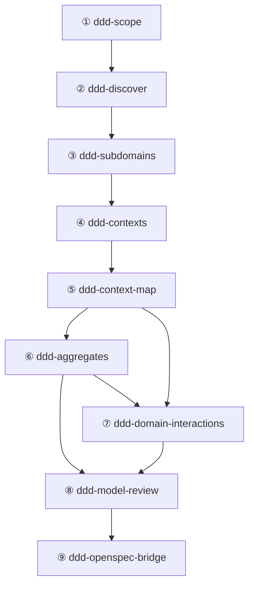

# แบบจำลองหลักของ Domain-Driven Design

> 🌐 English version: [English](ddd-skill-system-design.en.md)

ระบบโอเพนซอร์สมีความสามารถ DDD จุดเดียวจำนวนมาก แต่สิ่งที่ AI Agent ต้องการจริงๆ คือ **สายการจำลองที่ทำซ้ำได้และปิดลูปได้** : ตั้งแต่การค้นหาพื้นที่ปัญหาไปจนถึงการแยกกลยุทธ์ จากการจำลองทางยุทธวิธีไปจนถึงการตรวจสอบแบบจำลอง จนเกิดเป็นวงจรปิด ด้วยเหตุนี้ คลังข้อมูลนี้จึงกำหนดชุด `ddd-*` Skill ที่พัฒนาขึ้นเองภายใต้ `skills/` เป็นโครงสร้างหลัก — Skill แต่ละตัวเป็น **คำสั่งที่มีโครงสร้างสำหรับ AI Agent (LLM)** ที่ทำงานในรอบการสนทนาเดียวและสร้างชิ้นงานที่มีโครงสร้าง

**ขอบเขตการออกแบบ** : ระบบนี้ครอบคลุม **การจำลองขอบเขต** (กลยุทธ์ + ยุทธวิธี) และ **การเชื่อมต่อข้อกำหนดการนำร่อง** (เชื่อมต่อกับการนำร่องทางวิศวกรรมผ่าน OpenSpec) ไม่เกี่ยวข้องกับการเขียนโค้ดจริง กลยุทธ์การทดสอบ หรือการตรวจสอบความสอดคล้องของสถาปัตยกรรม

- `ddd-skills-report.md` — รายงานการสำรวจทักษะ Domain-Driven Design (พร้อมการอ้างอิงและ Backlog สำหรับปรับปรุง)
- `ddd-openspec-mapping.md` — คู่มือการแมป: นิยามมาตรฐานสำหรับการแปลงชิ้นงานยุทธวิธี DDD เป็นข้อกำหนด OpenSpec

---


---

## 1. หลักการทั่วไปและข้อกำหนด Skill อินเทอร์เฟซ

### 1.1 แบบจำลอง 5 ขั้นตอน

โครงสร้างหลักใช้ 5 ขั้นตอน (Stage) ซึ่งเป็นตัวแทน **5 ประเภทของการทำงานจำลองที่แตกต่างกัน** ไม่ใช่ขั้นตอนเชิงเส้นที่เข้มงวด:

| ขั้นตอน | ชื่อ                        | รูปแบบการรับรู้ | คำถามสำคัญ                                    |
| :------- | :-------------------------- | :------------- | :--------------------------------------------- |
| I        | การค้นหาพื้นที่ปัญหา (Discovery) | การสำรวจขยาย |เรากำลังแก้ปัญหาอะไร? ในขอบเขตมีอะไรเกิดขึ้นบ้าง? |
| II       | การจำลองกลยุทธ์ (Strategic)     | การวิเคราะห์แยกส่วน | ขอบเขตถูกแบ่งอย่างไร? จุด_BOUNDARYอยู่ที่ไหน? ภาษาจะปรับให้เป็นมาตรฐานได้อย่างไร? |
| III      | การจำลองยุทธวิธี (Tactical)      | การออกแบบที่แม่นยำ | บล็อกการสร้างภายในแต่ละBOUNDARYคืออะไร? จะทำงานร่วมกันอย่างไร? |
| IV       | การตรวจสอบแบบจำลอง (Validation)    | การตรวจสอบเชิงวิพากษ์ | แบบจำลองสอดคล้อง สมบูรณ์ และทำได้จริงหรือไม่? |
| V        | การเชื่อมต่อข้อกำหนด (Specification) | การแปลงและการแมป | จะแปลงแบบจำลองเป็นข้อกำหนดวิศวกรรมที่ทำงานได้อย่างไร? |

### 1.2 ความไม่เป็นเส้นตรงและวงจรปิดสองทาง

การจำลองขอบเขตไม่เป็นเส้นตรง (อ้างอิง R07) ระหว่างขั้นตอนมีกลไกป้อนกลับสองทาง:

- **การเดินหน้า** : จากการค้นหาไปจนถึงการตรวจสอบ แล้วส่งออกเป็นข้อกำหนดวิศวกรรม
- **การย้อนกลับ** : เมื่อขั้นตอนต่อมาค้นพบปัญหา จะย้อนกลับไปยังขั้นตอนก่อนหน้าโดยใช้ "เงื่อนไขการย้อนกลับ" ที่ชัดเจนเพื่อแก้ไข (ดู **ภาคผนวก B**)
- **ทางเข้าที่ไม่ใช่ลำดับ** : สำหรับระบบที่มีอยู่แล้ว สามารถเข้าได้จากทุกขั้นตอน (เช่น เริ่มจากการจำลองยุทธวิธีโดยตรง) โดยต้องเพิ่มบริบทที่จำเป็นสำหรับขั้นตอนนั้น

### 1.3 ข้อกำหนด Skill อินเทอร์เฟซ

SKILL.md ของ `ddd-*` Skill แต่ละตัวต้องมีโครงสร้างต่อไปนี้ เพื่อให้ AI Agent สามารถแยกวิเคราะห์และดำเนินการได้:

```yaml
---
name: ddd-<skill-name>
description: "<one-line description>"
risk: safe
source: self
tags: "[ddd, <stage>, <focus>]"
date_added: "<YYYY-MM-DD>"
---
```

เนื้อหาหลักต้องมีส่วนต่อไปนี้:

| ส่วน              | หน้าที่         | คำอธิบาย                                  |
| :---------------- | :-------------- | :---------------------------------------- |
| **เวลาที่ควรใช้** | เงื่อนไขทริกเกอร์ | ควรเรียกใช้ Skill นี้เมื่อใด             |
| **ข้อกำหนดอินพุต** | ความต้องการก่อนหน้า | อินพุตที่จำเป็นและอินพุตทางเลือก ระบุ Skill ที่เป็นต้นทาง |
| **ขั้นตอน**      | ขั้นตอนการดำเนินการ | ลำดับการดำเนินการของ AI Agent (5-7 ขั้นตอน) |
| **เอาต์พุต**     | ข้อกำหนดชิ้นงาน | ในรูปแบบตาราง: ชื่อชิ้นงาน + ข้อกำหนดโครงสร้าง |
| **รายการตรวจสอบ** | ประตูออก       | ทุกรายการต้องผ่านก่อนส่งมอบ             |
| **ทริกเกอร์ย้อนกลับ** | เงื่อนไขป้อนกลับ | เงื่อนไขเฉพาะสำหรับการกลับไป Skill ก่อนหน้า |
| **ตัวอย่าง**     | ตัวอย่างการเรียกใช้ | การใช้งานทั่วไปของ `@skill-name`       |

### 1.4 ทางเข้าที่ไม่ใช่ลำดับ

ไม่ใช่ทุกกรณีการใช้งานจะเริ่มจากขั้นตอน I ระบบรองรับรูปแบบทางเข้าต่อไปนี้:

| Skill ที่เข้า       | สถานการณ์ที่เหมาะสม                  | เงื่อนไขก่อนหน้า             |
| :------------------- | :------------------------------------- | :------------------------------ |
| `ddd-scope`          | โครงการใหม่หรือธุรกิจคลุมเครือ       | ไม่มี (จุดเริ่มต้น)            |
| `ddd-discover`       | ความต้องการชัดเจน ต้องการสำรวจขอบเขต | ผู้ใช้ให้ scope context       |
| `ddd-contexts`       | รู้แล้วว่ามี subdomain ต้องพัฒนาBOUNDARY | ผู้ใช้ให้การจำแนก subdomain   |
| `ddd-aggregates`     | ต้องเพิ่มความลึกทางยุทธวิธีสำหรับ context เดียว | ผู้ใช้ให้คำจำกัดความ context |
| `ddd-model-review`   | มีแบบจำลองอยู่แล้วต้องการประเมินคุณภาพ | ผู้ใช้ให้ชิ้นงานจำลองที่มีอยู่ |

---

## 2. การแมประหว่างขั้นตอนและทักษะ

### 2.1 ภาพรวมทักษะ (9 Skills)

#### ขั้นตอน I: การค้นหาพื้นที่ปัญหา

| Skill            | หน้าที่                                           | ผลลัพธ์หลัก                                             |
| :--------------- | :------------------------------------------------ | :------------------------------------------------------- |
| `ddd-scope`      | แปลงความต้องการคลุมเครือเป็นอินพุตจำลองที่ทำงานได้ | ข้อความปัญหา เป้าหมาย/ไม่ใช่เป้าหมาย เงื่อนไข คำศัพท์เบื้องต้น รายการความเสี่ยง |
| `ddd-discover`   | การค้นหาขอบเขตร่วมกัน (Event Storming / Domain Storytelling) | ตารางกระแสอีเวนต์ คำสั่ง/อีเวนต์ที่เป็นไปได้ การระบุจุดร้อน รายการความคลุมเครือ |

#### ขั้นตอน II: การจำลองกลยุทธ์

| Skill               | หน้าที่                       | ผลลัพธ์หลัก                                                    |
| :------------------ | :--------------------------- | :------------------------------------------------------------- |
| `ddd-subdomains`    | ระบุความสามารถทางธุรกิจและจำแนก subdomain | รายการความสามารถ ตารางจำแนก subdomain คำประกาศหลักของ core domain ข้อเสนอแนะเกี่ยวกับความเป็นเจ้าของ |
| `ddd-contexts`      | ออกแบบ Bounded Context และ Universal Language | สารบัญ context (หน้าที่ + ภาษา + ความเป็นเจ้าของ) 词汇表 Bounded Context ADR |
| `ddd-context-map`   | แมปความสัมพันธ์ระหว่าง context และกลยุทธ์การรวมระบบ | เมทริกซ์ความสัมพันธ์ รูปแบบการรวม สัญญาความเป็นเจ้าของ รูปแบบความล้มเหลว |

#### ขั้นตอน III: การจำลองยุทธวิธี

| Skill                       | หน้าที่                     | ผลลัพธ์หลัก                                                          |
| :-------------------------- | :-------------------------- | :-------------------------------------------------------------------- |
| `ddd-aggregates`            | ออกแบบBOUNDARY Aggregate จาก invariant | สารบัญ Aggregate (root + entity + value object) ตาราง invariant BOUNDARYธุรกรรม กลยุทธ์ความสอดคล้อง |
| `ddd-domain-interactions`   | ออกแบบกลไกการทำงานร่วมกันระหว่างบล็อกการสร้าง | สารบัญ Domain Event นิยาม Domain Service อินเทอร์เฟซ Repository รายการ Factory |

#### ขั้นตอน IV: การตรวจสอบแบบจำลอง

| Skill                | หน้าที่                       | ผลลัพธ์หลัก                           |
| :------------------- | :--------------------------- | :------------------------------------- |
| `ddd-model-review`   | การประเมินคุณภาพแบบจำลองโดยรวมและวงจรป้อนกลับ | คะแนนความสอดคล้อง รายการปัญหา รายการทริกเกอร์ย้อนกลับ |

#### ขั้นตอน V: การเชื่อมต่อข้อกำหนด

| Skill                   | หน้าที่                                           | ผลลัพธ์หลัก                                             |
| :---------------------- | :------------------------------------------------ | :------------------------------------------------------- |
| `ddd-openspec-bridge`   | แปลงชิ้นงานยุทธวิธี DDD เป็นข้อกำหนดที่มีโครงสร้าง OpenSpec | ชุดการเปลี่ยนแปลง OpenSpec (Proposal, Design, Specs, Tasks) |

### 2.2 แผนภาพความสัมพันธ์ของDependencies



### 2.3 ตารางการไหลของอินพุต/เอาต์พุต

| Skill ต้นทาง                    | ชิ้นงานที่ผลิต                                        | ผู้รับ                   |
| :------------------------------- | :------------------------------------------------------ | :----------------------- |
| ① `ddd-scope`                   | ข้อความปัญหา เป้าหมาย/ไม่ใช่เป้าหมาย เงื่อนไข คำศัพท์เบื้องต้น ความเสี่ยง | ② ③ ④ ⑨                |
| ② `ddd-discover`                | ตารางกระแสอีเวนต์ คำสั่ง/อีเวนต์ที่เป็นไปได้ จุดร้อน รายการความคลุมเครือ | ③ ④ ⑤ ⑥ ⑦ ⑨           |
| ③ `ddd-subdomains`              | รายการความสามารถ จำแนก subdomain คำประกาศหลัก       | ④ ⑤ ⑧ ⑨                |
| ④ `ddd-contexts`                | สารบัญ context Bounded Context ADR คำศัพท์            | ⑤ ⑥ ⑦ ⑧ ⑨              |
| ⑤ `ddd-context-map`             | เมทริกซ์ความสัมพันธ์ รูปแบบการรวม สัญญาความเป็นเจ้าของ รูปแบบความล้มเหลว | ⑥ ⑦ ⑧ ⑨                |
| ⑥ `ddd-aggregates`              | สารบัญ Aggregate ตาราง invariant BOUNDARYธุรกรรม     | ⑦ ⑧ ⑨                  |
| ⑦ `ddd-domain-interactions`     | สารบัญอีเวนต์ นิยามบริการ อินเทอร์เฟซ Repository รายการ Factory | ⑧ ⑨                    |
| ⑧ `ddd-model-review`            | คะแนน รายการปัญหา ทริกเกอร์ย้อนกลับ                  | ①②③④⑤⑥⑦ (ผ่านวงจรป้อนกลับ) ⑨ |
| ⑨ `ddd-openspec-bridge`         | OpenSpec Proposal/Design/Specs/Tasks                   | การนำร่อง (Implementation) |

#### 2.4 การเพิ่มประสิทธิภาพทางเลือก (Skill ภายนอก)

Skill หลักของโครงสร้างสามารถเชื่อมต่อ Skill ภายนอกเพื่อเพิ่มประสิทธิภาพได้ตามต้องการในทุกขั้นตอน:

| ขั้นตอน | โครงสร้างหลัก                                               | การเพิ่มประสิทธิภาพทางเลือก (ภายนอก)                                                                                             |
| :------- | :----------------------------------------------------------- | :-------------------------------------------------------------------------------------------------------------------------------- |
| I        | `ddd-scope`, `ddd-discover`                                  | `ddd-strategic-design` (การจำแนกเบื้องต้น), `ddd-planning` (แม่แบบ Event Storming)                                             |
| II       | `ddd-subdomains`, `ddd-contexts`, `ddd-context-map`          | `ddd-context-mapping` (เสริมสร้างรูปแบบการรวม), `domain-driven-design` (ตรวจสอบชิ้นงานกลยุทธ์)                                  |
| III      | `ddd-aggregates`, `ddd-domain-interactions`                  | `domain-driven-design` (กรอบการจำลองยุทธวิธี), `clean-ddd-hexagonal` (ต้นไม้ตัดสินใจกฎDependencies)                          |
| IV       | `ddd-model-review`                                           | `clean-architecture` (เสริมคะแนน)                                                                                                 |
| V        | `ddd-openspec-bridge`                                        | `openspec-assistant` (การสร้างและการตรวจสอบข้อกำหนด)                                                                             |

---

## 3. แหล่งอ้างอิงและการแมป Skill

เพื่อสนับสนุนการปรับปรุงอย่างต่อเนื่องของโครงสร้างหลัก `skills/ddd-*` ในอนาคต ส่วนนี้จะแปลงแหล่งเรียนรู้ฟรีจาก `ddd-crew/free-ddd-learning-resources` ให้เป็นรายการอ้างอิงที่นำกลับมาใช้ซ้ำได้ และระบุตำแหน่ง Skill และส่วนที่แต่ละแหล่งสามารถเสริมสร้างได้โดยตรง เพื่อให้มั่นใจว่าการเปลี่ยนแปลงสามารถตรวจสอบย้อนกลับ นำกลับมาใช้ซ้ำได้ และพัฒนาเป็นชุดๆ ได้

### 3.1 รายการอ้างอิง (พร้อมข้อมูลเมตา)

เพื่อให้มั่นใจในความน่าเชื่อถือและความครอบคลุมของแหล่งทฤษฎี รายการด้านล่างรวบรวมผลงานคลาสสิก คู่มือการปฏิบัติ และกรณีศึกษาใน领域的域Driven Design เอกสารเหล่านี้ครอบคลุมการออกแบบกลยุทธ์ การจำลองร่วมกัน และการนำยุทธวิธีไปใช้จริงในหลายมิติ ซึ่งเป็นฐานความรู้สำหรับการปรับปรุงโครงสร้างหลักในอนาคต

| ID  | หัวข้อ                    | ชื่อเรื่อง                                                    | ประเภท          | ผู้แต่ง/องค์กร                          | ปี    | ลิงก์                                                                                                          |
| :-- | :------------------------ | :------------------------------------------------------------ | :-------------- | :--------------------------------------- | :---- | :------------------------------------------------------------------------------------------------------------- |
| R01 | Fundamentals              | Domain-Driven Design Reference                                | EBook (PDF)     | Eric Evans                               | 2015  | https://domainlanguage.com/wp-content/uploads/2016/05/DDD_Reference_2015-03.pdf                               |
| R02 | Fundamentals              | Domain-Driven Design Quickly                                  | EBook           | Abel Avram, Floyd Marinescu              |       | https://www.infoq.com/minibooks/domain-driven-design-quickly/                                                 |
| R03 | Fundamentals              | DDD: The First 15 Years                                       | EBook           | Various Authors                          |       | https://leanpub.com/ddd_first_15_years                                                                        |
| R04 | Fundamentals              | The Anatomy of Domain-Driven Design                           | EBook           | Scott Millett, Samuel Knight             |       | https://leanpub.com/theanatomyofdomain-drivendesign                                                           |
| R05 | Fundamentals              | Domain-Driven Design                                          | Article         | Martin Fowler                            |       | https://martinfowler.com/bliki/DomainDrivenDesign.html                                                        |
| R06 | Fundamentals              | Domain-driven design needn't be hard. Here's how to start     | Article         | Thoughtworks (Andrew Hamel-law)          |       | https://www.thoughtworks.com/insights/blog/domain-driven-design-neednt-be-hard-heres-how-start                |
| R07 | Process                   | DDD Starter Modelling Process                                 | Repo            | `ddd-crew`                               |       | https://github.com/ddd-crew/ddd-starter-modelling-process                                                     |
| R08 | Fundamentals              | What is DDD?                                                  | Video           | Eric Evans                               |       | https://www.youtube.com/watch?v=pMuiVlnGqjk                                                                   |
| R09 | Fundamentals              | Tackling Complexity in the Heart of Software                  | Video           | Eric Evans                               |       | https://www.youtube.com/watch?v=dnUFEg68ESM                                                                   |
| R10 | Collaborative Modelling   | Event Storming                                                | Practice        | Open Practice Library                    |       | https://openpracticelibrary.com/practice/event-storming/                                                      |
| R11 | Collaborative Modelling   | Domain Storytelling                                           | Practice        | Open Practice Library                    |       | https://openpracticelibrary.com/practice/domain-storytelling/                                                 |
| R12 | Collaborative Modelling   | 100,000 Orange Stickies Later                                 | Video           | Alberto Brandolini                       |       | https://www.youtube.com/watch?v=fGm62ra_mQ8                                                                   |
| R13 | Collaborative Modelling   | Awesome EventStorming                                         | Repo            | Mariusz Gil                              |       | https://github.com/mariuszgil/awesome-eventstorming                                                           |
| R14 | Strategic Design          | Bounded Context                                               | Article         | Martin Fowler                            |       | https://martinfowler.com/bliki/BoundedContext.html                                                            |
| R15 | Strategic Design          | Bounded Contexts                                              | Video           | Cyrille Martraire                        |       | https://www.youtube.com/watch?v=ZEJ2Vyk1HA0                                                                   |
| R16 | Strategic Design          | Practical DDD: Bounded Contexts + Events                      | Video           | Indu Alagarsamy                          |       | https://www.youtube.com/watch?v=Nr6jAwOunGM                                                                   |
| R17 | Strategic Design          | Emergent Boundaries                                           | Article/Video   | Matthias Verraes                         | 2017  | https://verraes.net/2017/04/emergent-boundaries/                                                              |
| R18 | Strategic Design          | Socio-technical architecture                                  | Video           | Ora Egozi Barzilai, Evelyn van Kelle     |       | https://www.youtube.com/watch?v=9Ft39wz6fHM                                                                   |
| R19 | Tactical DDD              | All Our Aggregates Are Wrong                                  | Video           | Mauro Servienti                          |       | https://www.youtube.com/watch?v=KkzvQSuYd5I                                                                   |
| R20 | Strategic Design          | Aligning organization and architecture with strategic DDD     | Slides          | Michael Plöd                             |       | https://speakerdeck.com/mploed/aligning-organization-and-architecture-with-strategic-ddd                      |
| R21 | Strategic Design          | Strategic Domain-Driven Design Kata: Delivericious            | Case Study      | Nick Tune                                |       | https://medium.com/nick-tune-tech-strategy-blog/strategic-domain-driven-design-kata-delivericious-b114ca77163 |
| R22 | Tactical DDD              | Architecture Patterns with Python                             | EBook           | Harry Percival, Bob Gregory              |       | http://www.cosmicpython.com                                                                                   |
| R23 | Tactical DDD              | Aggregates & Entities in Domain-Driven Design                 | Article         | Paul Rayner                              |       | http://thepaulrayner.com/blog/aggregates-and-entities-in-domain-driven-design/                                |
| R24 | Tactical DDD              | Strengthening your domain: a primer                           | Article         | Jimmy Bogard                             | 2010  | https://lostechies.com/jimmybogard/2010/02/04/strengthening-your-domain-a-primer/                             |
| R25 | Tactical DDD              | Domain Modeling Made Functional                               | Video           | Scott Wlaschin                           |       | https://www.youtube.com/watch?v=1pSH8kElmM4                                                                   |
| R26 | Tactical DDD              | Design in the small                                           | Video           | Yves Reynhout                            |       | https://www.youtube.com/watch?v=3iLW4puXHvc                                                                   |
| R27 | Engineering               | Refactoring for DDD Without Microservicing Your Monolith      | Video           | Harry Brumleve                           |       | https://www.youtube.com/watch?v=y2mL-6CcYBw                                                                   |
| R28 | Tactical DDD              | DDD By Examples                                               | Repo            | Jakub Pilimon, Bartłomiej Słota          |       | https://github.com/ddd-by-examples/library                                                                    |
| R29 | Case Study                | 10 Lessons from a Long Running DDD Project (Part 1)           | Article         | Jimmy Bogard                             | 2016  | https://lostechies.com/jimmybogard/2016/06/13/10-lessons-from-a-long-running-ddd-project-part-1/              |
| R30 | Case Study                | OOps I DDD it again and again                                 | Slides          | Ora Egozi-Barzilai                       |       | https://www.slideshare.net/OraEgoziBarzilai/mucon-2019-oops-i-ddd-it-again-and-again                          |

### 3.2 การแมปจากอ้างอิง → Skill/ส่วนที่พัฒนาเอง (Backlog ที่แนะนำ)

การแปลงความรู้ภายนอกให้เป็นข้อกำหนดจำลองที่ทำงานได้เป็นกุญแจสำคัญในการพัฒนาระบบ ตารางด้านล่างสร้างการแมปโดยตรงจากเอกสารทฤษฎีไปยังจุดที่ต้องปรับปรุง Skill โดยจัดลำดับความสำคัญจาก P0 ถึง P2 ตามมูลค่าทางธุรกิจและระดับความขาดแคลน เพื่อให้งาน Backlog สำหรับการพัฒนาทักษะในอนาคตมีความชัดเจน

| อ้างอิง ID | ลำดับความสำคัญ | สถานะ | Skill เป้าหมาย                | ส่วนเป้าหมาย           | จุดที่แนะนำให้แก้ไข                                                                                   |
| :---------- | :------------- | :---- | :----------------------------- | :---------------------- | :----------------------------------------------------------------------------------------------------- |
| R07         | P0             | Done  | กฎเกณฑ์ระดับบนสุดโดยรวม         | หลักการทั่วไป           | ~~引入"非线性、可回环"的建模过程原则~~ → ได้ Implemented แล้วใน §1.2 ความไม่เป็นเส้นตรงและวงจรปิดสองทาง   |
| R06         | P1             | Open  | `ddd-scope`                    | ขั้นตอน / เอาต์พุต     | เพิ่มวิธีการเริ่มต้น DDD แบบเป็นขั้นตอนของ Thoughtworks เสริมกรอบการตัดสินใจ "เริ่มจากที่ไหน" ในการ收敛 scope |
| R09         | P2             | Open  | `ddd-scope`                    | ขั้นตอน / รายการตรวจสอบ | เพิ่มข้อคิดเกี่ยวกับ "การจำลองในแกนกลางของความซับซ้อน" เพื่อหลีกเลี่ยงการลงทุนเกินไปในการจำลอง Domain ที่ไม่ใช่แกนหลัก |
| R10         | P0             | Open  | `ddd-discover`                 | ขั้นตอน / เอาต์พุต     | เพิ่มขั้นตอนมาตรฐานของ Event Storming และบทบาทผู้เข้าร่วม ทำให้กระแสผิดปกติ จุดร้อน การจัดการความคลุมเครือเป็นเอาต์พุตมาตรฐาน |
| R12         | P1             | Open  | `ddd-discover`                 | ทริกเกอร์ย้อนกลับ       | เพิ่มรูปแบบความล้มเหลวทั่วไปของการจำลองร่วมกันใน規模ใหญ่: จังหวะการดำเนินงาน ความสอดคล้องของความหมายสติกกี้ การแก้ไขความขัดแย้ง และการตกผลึกหลังประชุม |
| R11         | P1             | Open  | `ddd-discover`                 | ขั้นตอน (วิธีทางเลือก) | นำ Domain Storytelling มาเป็นวิธีค้นหาทางเลือกแทน Event Storming เพิ่มโครงสร้างการเล่าเรื่อง "บทบาท-การกระทำ-วัตถุ" |
| R21         | P1             | Open  | `ddd-subdomains`               | เอาต์พุต / ตัวอย่าง     | ให้รูปแบบการฝึก Kata ที่นำกลับมาใช้ซ้ำได้และแม่แบบเอาต์พุต แปลงผลผลิตจากการฝึกเป็นตารางจำแนก subdomain และคำประกาศ Domain หลัก |
| R18         | P1             | Open  | `ddd-subdomains`               | ขั้นตอน / ข้อเสนอแนะความเป็นเจ้าของ | นำมุมมองสถาปัตยกรรมสังคมและเทคนิคมาใช้: ผลกระทบของ Conway's Law ต่อการแบ่ง subdomain จากภาระรับรู้ของทีม |
| R14         | P0             | Open  | `ddd-contexts`                 | ขั้นตอน / รายการตรวจสอบ | เสริมสร้างBOUNDARYภาษาและBOUNDARYแบบจำลองของ Bounded Context เพิ่มรายการตรวจสอบ "ไม่ใช่หน้าที่" และ "ความขัดแย้งของความเป็นเจ้าของข้อมูล" |
| R20         | P0             | Open  | `ddd-contexts`                 | เอาต์พุต / ADR          | นำมุมมองการจัดตำแหน่งขององค์กรและสถาปัตยกรรมมาใช้: ขอบเขตทีม เจ้าของ สิทธิ์การตัดสินใจ เพิ่มข้อเตือนความเสี่ยง "BOUNDARYไม่พัฒนาตามทีม" |
| R15         | P1             | Open  | `ddd-contexts`                 | ขั้นตอน                 | นำมุมมองวงจรชีวิต Bounded Context ของ Cyrille Martraire มาใช้: วัยเริ่มต้น วัยผู้ใหญ่ Bounded Context แบบฟองอากาศและอิสระ |
| R17         | P1             | Open  | `ddd-contexts`                 | ทริกเกอร์ย้อนกลับ       | นำแนวคิด "BOUNDARYแบบEmergent" มาใช้: BOUNDARYไม่ใช่การตัดสินใจครั้งเดียว ต้องสังเกตและปรับปรุงอย่างต่อเนื่อง ระบุสัญญาณที่ควรทริกเกอร์การ重新划分BOUNDARY |
| R16         | P0             | Open  | `ddd-context-map`              | ขั้นตอน / เอาต์พุต     | นำรูปแบบการปฏิบัติ Bounded Context + Events มาใช้: วาดแผนที่ context โดยใช้อีเวนต์เป็นเบาะแส เสริมสร้างการค้นพบสัญญา |
| R27         | P1             | Open  | `ddd-context-map`              | รูปแบบความล้มเหลว / การตัดสินใจแปลง | นำกลยุทธ์ "ไม่แยกไมโครเซอร์วิสอย่างรุนแรงในโครงการที่มีอยู่" มาใช้: สร้างBOUNDARYACL ก่อน แล้วค่อยแยกอย่างค่อยเป็นค่อยไป เพิ่มรูปแบบการรวมระบบเก่า |
| R23         | P0             | Open  | `ddd-aggregates`               | ขั้นตอน / รายการตรวจสอบ | ทำให้หลักการสำคัญในการแบ่ง Aggregate ชัดเจน: invariant BOUNDARYธุรกรรม การอ้างอิงข้าม Aggregate เพิ่มการตรวจสอบตัวอย่างกลับด้าน "ใช้คีย์ต่างชาติเป็นBOUNDARYAggregate" |
| R19         | P0             | Open  | `ddd-aggregates`               | ทริกเกอร์ย้อนกลับ       | เพิ่มชุดanti-pattern "Aggregate มักแบ่งผิด" และขั้นตอนแก้ไข: แยกBOUNDARYความสอดคล้องให้เล็กลง ใช้ event-driven consistency สุดท้าย กลยุทธ์การชดเชย |
| R24         | P1             | Open  | `ddd-aggregates`               | รายการตรวจสอบ            | เสริมสร้างข้อกำหนด "ความแข็งแรง" ของแบบจำลอง: ให้ความสำคัญกับการแสดง invariant เพิ่มเกณฑ์การตัดสิน Aggregate ที่อ่อนแอและเส้นทางการปรับปรุง |
| R26         | P2             | Open  | `ddd-aggregates`               | ขั้นตอน (Entity/Value Object) | นำแนวคิด "การออกแบบในขนาดเล็ก" ของ Yves Reynhout มาใช้: Value Object มาก่อน Entity ให้น้อยที่สุด ความอุดมสมบูรณ์ของพฤติกรรม Aggregate Root |
| R25         | P1             | Open  | `ddd-domain-interactions`      | ขั้นตอน / เอาต์พุต     | นำมุมมองการจำลองแบบฟังก์ชันมาใช้: ใช้ระบบtypeแสดงDomain Event และการเปลี่ยนแปลงสถานะ เสริมความแม่นยำของสัญญาอีเวนต์ |
| R22         | P1             | Open  | `ddd-domain-interactions`      | อินเทอร์เฟซ Repository / ขั้นตอน | ให้รูปแบบอ้างอิงสำหรับการออกแบบอินเทอร์เฟซ Repository ในการจำลอง: การโหลดAggregate สัญญาการบันทึกข้อมูล และBOUNDARYการสืบค้น |
| R28         | P1             | Open  | `ddd-domain-interactions`      | ตัวอย่าง                | นำรูปแบบการออกแบบ event-driven จาก DDD By Examples (กรณี Library) มาเป็นตัวอย่างอ้างอิงสำหรับการออกแบบDomain Interaction |
| R29         | P1             | Open  | `ddd-model-review`             | รายการปัญหา / ทริกเกอร์ย้อนกลับ | แยกลักษณะทั่วไปจากประสบการณ์โครงการระยะยาว: BOUNDARYที่เลื่อนไหล อีเวนต์ที่ล้น คำศัพท์ที่เสื่อมสภาพ ระบุเงื่อนไขทริกเกอร์ย้อนกลับอย่างละเอียด |
| R30         | P2             | Open  | `ddd-model-review`             | มิติคะแนน               | นำบทเรียนจาก "DDD ทำผิดซ้ำแล้วซ้ำเล่า" มาใช้เพิ่มสัญญาณทั่วไปของการเสื่อมสภาพของแบบจำลองและมาตรการป้องกัน |
| R03         | P2             | Open  | `ddd-model-review`             | รายการตรวจสอบ           | แยกเกณฑ์การวัดคุณภาพแบบจำลองระยะยาวและรูปแบบวิวัฒนาการจากประสบการณ์ของผู้ปฏิบัติงานหลายคนใน "DDD 15 ปี" |

> **หมายเหตุ** :
>
> - R13 (`Awesome EventStorming`) จัดอยู่ในหมวด "เครื่องมือและคลังทรัพยากร" ไม่ได้เป็นเป้าหมายโดยตรงสำหรับการเสริมสร้าง แต่เป็นฐานข้อมูลสำหรับอ่านเพิ่มเติมสำหรับ `ddd-discover`
> - R01-R05, R08 จัดอยู่ในทฤษฎีพื้นฐาน DDD เป็นฐานความรู้สำหรับ Skill ทั้งหมด ไม่ได้แมปกับจุดที่ต้องปรับปรุงเฉพาะเจาะจง

---

## ภาคผนวก A: ตัวอย่างเริ่มต้นอย่างรวดเร็ว (ใช้ "ระบบจองห้องประชุม" เป็นตัวอย่าง)

ภาคผนวกนี้แสดงตัวอย่างความร่วมมือของ Skill ทั้ง 9 ของโครงสร้างหลักในสถานการณ์จริง (ตัวอย่างในส่วนนี้เน้นที่ขั้นตอน I–IV ของการทำงานจำลองร่วมกัน ตัวอย่างเอาต์พุตข้อกำหนดของขั้นตอน V `ddd-openspec-bridge` ดูที่ [ddd-openspec-mapping.md](ddd-openspec-mapping.md))

### A.1 ขั้นตอน I: การค้นหาพื้นที่ปัญหา

**`ddd-scope`（①）**

- **อินพุต**: วิสัยทัศน์ทางธุรกิจ: "ต้องการให้พนักงานจองห้องประชุมที่ว่างได้ตลอดเวลา เพื่อหลีกเลี่ยงความขัดแย้งของเวลา"
- **เอาต์พุต**:
  - ข้อความปัญหา: "ทรัพยากรห้องประชุมไม่มีการจัดการส่วนกลาง ความขัดแย้งของเวลาเกิดขึ้นบ่อยทำให้ประสิทธิภาพของพนักงานลดลง"
  - เป้าหมาย: สนับสนุนการจองตามช่วงเวลา การตรวจจับความขัดแย้ง การยืนยันการเช็คอิน
  - ไม่ใช่เป้าหมาย: ไม่เกี่ยวกับการซ่อมบำรุงอุปกรณ์ห้องประชุม ไม่เกี่ยวกับการจัดประชุมทางไกล
  - เงื่อนไข: ระยะเวลาจองต้องเป็นจำนวนเท่าของ 30 นาที แต่ละคนจองได้สูงสุด 1 รายการต่อช่วงเวลา
  - คำศัพท์เบื้องต้น: การจอง (Booking), ห้องประชุม (Room), ช่วงเวลา (TimeSlot), การเช็คอิน (CheckIn)
- **รายการตรวจสอบ**:
  - [x] เป้าหมายและไม่ใช่เป้าหมาย mutually exclusive และทำได้จริง
  - [x] เงื่อนไขสามารถตรวจสอบได้

**`ddd-discover`（②）**

- **อินพุต**: scope output จาก ①
- **เอาต์พุต (ตัวอย่างกระแสอีเวนต์)**:

  | ลำดับ | อีเวนต์             | คำสั่งที่ทริกเกอร์  | ผู้มีส่วนร่วม | เส้นทางผิดปกติ                        |
  | :---- | :------------------ | :------------------- | :------------- | :------------------------------------- |
  | 1     | RoomRegistered      | RegisterRoom         | Admin          | —                                      |
  | 2     | BookingRequested    | RequestBooking       | Employee       | ช่วงเวลาเต็ม → BookingRejected        |
  | 3     | BookingConfirmed    | ConfirmBooking       | System         | ตรวจจับความขัดแย้งล้มเหลว → BookingRejected |
  | 4     | CheckInRecorded     | RecordCheckIn        | Employee       | หมดเวลาไม่เช็คอิน → BookingCancelled |

- **การระบุจุดร้อน**: BookingConfirmed เป็นจุดความสอดคล้องสูง (การแข่งขันเวลาพร้อมกัน)
- **ความคลุมเครือ**: "การจอง" เป็นการขอหรือยืนยันแล้ว? ต้องแยกแยะสองสถานะอย่างชัดเจน

### A.2 ขั้นตอน II: การจำลองกลยุทธ์

**`ddd-subdomains`（③）**

| ความสามารถ               | ประเภท subdomain | เหตุผล                                                    |
| :------------------------ | :--------------- | :-------------------------------------------------------- |
| การจองและการจัดการความขัดแย้ง | Core             | ความสามารถหลัก: การตรวจจับความขัดแย้งของเวลาที่แม่นยำและการควบคุมพร้อมกัน |
| การจัดการทรัพยากรห้องประชุม | Supporting       | จำเป็นแต่ไม่เป็นจุดแตกต่าง                               |
| ตัวตนและสิทธิ์ผู้ใช้     | Generic          | ความสามารถทั่วไป สามารถนำกลับมาใช้ซ้ำได้ในระบบที่มีอยู่ |

**`ddd-contexts`（④）**

| Context      | หน้าที่                                       | คำศัพท์หลัก                           | ความเป็นเจ้าของ |
| :----------- | :--------------------------------------------- | :------------------------------------- | :--------------- |
| Booking      | วงจรชีวิตทั้งหมดของการจอง: ขอ ยืนยัน ยกเลิก เช็คอิน | Booking, TimeSlot, BookingPolicy      | ทีมจอง           |
| Room Catalog | การลงทะเบียนห้องประชุม ความจุ อุปกรณ์ ความพร้อมใช้งาน | Room, Capacity, Equipment             | ทีมธุรการ        |
| Identity     | การยืนยันตัวตนและอนุญาตผู้ใช้                 | User, Role, Permission                | ทีมแพลตฟอร์ม    |

- **BOUNDARY ADR**: ใน Context Booking, Room เป็นเพียงการอ้างอิง RoomId ไม่ได้ถือรายละเอียด Room ต้องสอบถามเพื่อขอความพร้อมใช้งาน
- **การจัดการขัดแย้งคำศัพท์**: "Room" ใน Booking คือ RoomId (identifier) ใน Room Catalog คือ Entity เต็มรูปแบบ

**`ddd-context-map`（⑤）**

| ต้นน้ำ       | ปลายน้ำ | รูปแบบ                     | คำอธิบาย                                      |
| :----------- | :------- | :------------------------- | :--------------------------------------------- |
| Room Catalog | Booking  | OHS (Open Host Service)    | Booking สอบถามรายชื่อห้องประชุมที่ว่าง      |
| Identity     | Booking  | ACL (Anti-Corruption Layer)| Booking แปลง UserId เป็นแนวคิด Booker         |

- **รูปแบบความล้มเหลว**: เมื่อ Room Catalog ไม่พร้อมใช้งาน Booking จะลดระดับเป็น "อนุญาตเฉพาะ RoomId ที่รู้จักเท่านั้น"

### A.3 ขั้นตอน III: การจำลองยุทธวิธี

**`ddd-aggregates`（⑥）**

| Aggregate | Aggregate Root | องค์ประกอบ                        | Invariant สำคัญ                                                  |
| :-------- | :------------- | :-------------------------------- | :--------------------------------------------------------------- |
| Booking   | Booking        | TimeSlot (VO), BookingStatus (VO) | 在同一 Room同一 TimeSlot 不得有两个 Confirmed Booking |
| Room      | Room           | Capacity (VO), Equipment (VO)     | Room 必须有唯一标识与非零容量                                          |

- **BOUNDARYธุรกรรม**: โดยปกติธุรกรรมเดียวแก้ไข Aggregate เดียว
- **ความสอดคล้องข้าม Aggregate**: เมื่อยืนยัน Booking ต้องสอบถามความพร้อมใช้งาน Room → ทำได้ผ่าน Domain Event + 乐观锁

**`ddd-domain-interactions`（⑦）**

| Domain Event       | Aggregate ต้นทาง | เงื่อนไขทริกเกอร์ | ผู้รับ                  | Idempotent Key          |
| :----------------- | :---------------- | :----------------- | :---------------------- | :---------------------- |
| BookingConfirmed   | Booking           | ตรวจจับความขัดแย้งผ่าน | บริการแจ้งเตือน (ภายนอก) | BookingId + Version     |
| BookingCancelled   | Booking           | หมดเวลาไม่เช็คอิน   | Room Catalog (คืนช่วงเวลา) | BookingId               |

- **อินเทอร์เฟซ Repository**: `BookingRepository.findByRoomAndTimeSlot(roomId, timeSlot)` — สำหรับตรวจจับความขัดแย้ง
- **Domain Service**: `ConflictDetectionService` — ตรวจสอบข้าม Aggregate Booking ว่าช่วงเวลาเดียวกันถูกใช้งานแล้วหรือไม่

### A.4 ขั้นตอน IV: การตรวจสอบแบบจำลอง

**`ddd-model-review`（⑧）**

| มิติ                  | คะแนน | การค้นพบ                                                                  |
| :-------------------- | :---- | :------------------------------------------------------------------------- |
| ความสอดคล้องคำศัพท์   | 9/10  | "Room" ข้าม context มีความหมายที่แยกแยะชัดเจนแล้ว                         |
| BOUNDARYAggregate     | 7/10  | ConflictDetectionService ต้องสอบถามข้าม Aggregate → แนะนำให้ประเมินว่าจำเป็นต้องปรับBOUNDARYหรือไม่ |
| ความสมบูรณ์ของอีเวนต์ | 8/10  | ขาดคำนิยามอย่างเป็นทางการของ BookingRejected Event                       |

- **ทริกเกอร์ย้อนกลับ**: คะแนน Aggregate 7/10 → แนะนำกลับไป ⑥ `ddd-aggregates` ประเมินว่าควรปรับ TimeSlot ความพร้อมใช้งานเป็น Aggregate อิสระ (RoomSchedule) เพื่อขจัดการสอบถามข้าม Aggregate หรือไม่

### A.5 ตัวอย่างวงจรป้อนกลับ

การประเมินข้างต้นทริกเกอร์การย้อนกลับไปยัง ⑥ `ddd-aggregates`:

- **แผนปรับแก้**: แนะนำ `RoomSchedule` Aggregate ถือสถานะการใช้งานช่วงเวลาทั้งหมดของ Room
- **Invariant ใหม่**: ภายใน RoomSchedule同一 TimeSlot อนุญาต Confirmed ได้เพียงรายการเดียว
- **ผลกระทบ**: ConflictDetectionService ถูกลบออก การตรวจจับความขัดแย้งกลายเป็น invariant ของ RoomSchedule Aggregate
- **ตรวจสอบใหม่**: คะแนน Aggregate เพิ่มเป็น 9/10 ไม่มีทริกเกอร์ย้อนกลับใหม่

---

## ภาคผนวก B: เมทริกซ์เงื่อนไขทริกเกอร์ย้อนกลับ

เมทริกซ์ด้านล่างทำให้ปัญหาที่อาจพบในการดำเนินการ Skill แต่ละตัวเป็นกฎการย้อนกลับที่ทำงานได้ เพื่อหลีกเลี่ยงความไม่สม่ำเสมอของการตัดสินจากประสบการณ์:

| Skill ที่ตรวจจับ                  | เงื่อนไขทริกเกอร์                                                              | ย้อนกลับไป | Skill ที่ต้องดำเนินการใหม่                       | คำอธิบาย                                            |
| :---------------------------------- | :------------------------------------------------------------------------------- | :--------- | :------------------------------------------------ | :-------------------------------------------------- |
| ⑧ `ddd-model-review`               | BOUNDARYAggregate ขัดแยวกับBOUNDARYContext                                     | ขั้นตอน II | `ddd-contexts`                                   | Context ต้องแบ่งใหม่เพื่อรองรับความต้องการความสอดคล้อง |
| ⑧ `ddd-model-review`               | อัตราขัดแย้งคำศัพท์ > 20%                                                      | ขั้นตอน II | `ddd-contexts`                                   | นิยาม Universal Language ไม่เพียงพอ ต้องจัดตำแหน่งใหม่  |
| ⑧ `ddd-model-review`               | อัตราการแสดง invariant < 60% (Aggregate ขาด invariant ที่ชัดเจน)                | ขั้นตอน III| `ddd-aggregates`                                 | Aggregate อาจเป็นถังข้อมูลไม่ใช่BOUNDARYพฤติกรรม    |
| ⑧ `ddd-model-review`               | รูปแบบการรวมไม่สอดคล้องกับBOUNDARYMap                                          | ขั้นตอน II | `ddd-context-map`                                | ชั้นยุทธวิธีค้นพบความต้องการรวมใหม่              |
| ⑧ `ddd-model-review`               | ความสมบูรณ์ของอีเวนต์ < 70% (สารบัญอีเวนต์ขาดหรือไม่ครอบคลุมกระแสหลัก)      | ขั้นตอน III| `ddd-domain-interactions`                        | สารบัญอีเวนต์ขาดหรือไม่ครอบคลุมกระแสหลัก        |
| ⑦ `ddd-domain-interactions`        | อีเวนต์ต้องพกข้อมูลส่วนตัวของอีก Aggregate (ไม่สามารถออกแบบschemaอีเวนต์ที่สะอาดได้) | ขั้นตอน III| `ddd-aggregates`                                 | BOUNDARYAggregateต้องปรับเพื่อให้อีเวนต์ self-contained |
| ⑥ `ddd-aggregates`                 | Invariant ข้ามหลาย Context                                                      | ขั้นตอน II | `ddd-contexts`                                   | ความต้องการความสอดคล้องถูกBOUNDARYContext ตัดขาด   |
| ⑤ `ddd-context-map`                | วงจรพึ่งพาหรือ Context เดียวรับความสัมพันธ์ต้นน้ำ > 3 รายการ                   | ขั้นตอน II | `ddd-subdomains` / `ddd-contexts`                | อาจมี "上帝Context" หรือ subdomain ถูกแบ่งผิด        |
| ④ `ddd-contexts`                   | มีคำศัพท์ > 5 คำที่ขัดแย้งกันข้าม context อย่างไม่สามารถไกล่เกลี่ยได้          | ขั้นตอน I  | `ddd-discover`                                   | เข้าใจขอบเขตไม่เพียงพอ ต้องค้นหาใหม่              |
| ③ `ddd-subdomains`                 | ไม่สามารถแยก core domain กับ supporting domain (ไม่มีความสามารถที่แตกต่าง)     | ขั้นตอน I  | `ddd-scope`                                      | ข้อเสนอvalueทางธุรกิจไม่ชัดเจน                     |

> **ป้องกันวงจรไม่สิ้นสุด**: เส้นทางย้อนกลับเดียวกันดำเนินการสูงสุด 3 ครั้ง หากครั้งที่ 3 ยังทริกเกอร์ ควรยกระดับไป `ddd-scope` เพื่อจัดตำแหน่งเป้าหมายธุรกิจใหม่ หรือทำเครื่องหมาย "ต้องการการแทรกแซงของมนุษย์ในการตัดสินใจสถาปัตยกรรม"