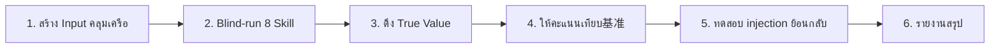

# วิธีตรวจสอบ Skill DDD (Validation Method)

> 🌐 English version: [English](README.en.md)

---

> ไดเรกทอรีนี้บันทึก **วิธีตรวจสอบ end-to-end** สำหรับ DDD Modeling Skill 8 ตัวที่พัฒนาขึ้นเอง ตลอดจนกรณีตรวจสอบที่เสร็จสมบูรณ์แล้ว
>
> **ขอบเขตการตรวจสอบ**: สาย流水线 blind-run ครอบคลุมขั้นตอน I (ค้นพบ) – IV (ตรวจสอบ) จำนวน 8 Skill; ขั้นตอน V `ddd-openspec-bridge` (การเชื่อมต่อข้อกำหนด OpenSpec) ตั้งแต่ 2026-08 เป็นต้นมา ได้รับการ纳入การตรวจสอบผ่านกรณี [insurance-validation](./insurance-validation/) ไฟล์ `09-ddd-openspec-bridge.out.md`
>
> กรณีปัจจุบัน: [cargo-validation](./cargo-validation/) — ใช้ DDD Sample การขนส่ง Cargo ของ Eric Evans + Citerus เป็น True Value อ้างอิง

## 1. วัตถุประสงค์ของวิธี

ทำการประเมินคุณภาพแบบ Objective สำหรับสาย流水线 Modeling ที่ประกอบด้วย 8 Skill ในขั้นตอน I–IV ของ `skills/` ตอบคำถาม 3 ข้อ:

1. หากไม่มีคำแนะนำศัพท์ DDD สาย流水线สามารถแปลงคำอธิบายธุรกิจที่คลุมเครือให้เป็นโมเดล Domain ที่ใช้งานได้หรือไม่?
2. ผลงานเบี่ยงเบนจากตัวอย่างมาตรฐานอุตสาหกรรมมากเพียงใด เบี่ยงเบนในทางบวกหรือทางลบ?
3. กลไกย้อนกลับของ `ddd-model-review` สามารถ activation ปิดลูป feedback ได้อย่างถูกต้องเมื่อโมเดลเสื่อมสภาพหรือไม่?

## 2. หลักการของวิธี

| หลักการ              | คำอธิบาย                                                                                                                |
| :-------------------- | :----------------------------------------------------------------------------------------------------------------------- |
| **Blind-Run**         | ขณะ execute แต่ละ Skill สามารถเข้าถึงเฉพาะ Input upstream ที่ Skill กำหนดไว้เท่านั้น **ห้าม** อ่านการ implement อ้างอิง, ไฟล์ True Value หรือเอกสารใดๆ ที่เปิดเผยศัพท์ DDD และชื่อคลาส |
| **True Value แยกต่างหาก** | True Value (Ground Truth) ถูกดึงออกมาอย่างอิสระไปยังไดเรกทอรี `reference/` แยกจากผลงาน blind-run อย่างสมบูรณ์; ใช้เฉพาะหลังจาก blind-run เสร็จสิ้นสำหรับการให้คะแนน |
| **ตรวจสอบได้**       | ทุกรายการหัก/เพิ่มคะแนนต้องอ้างอิงรายการผลงานเฉพาะเป็นหลักฐาน; คะแนนสามารถทำซ้ำได้ (Input เดียวกันได้คะแนนเท่ากัน) |
| **ทดสอบย้อนกลับ**   | ฉีดข้อบกพร่องที่ควบคุมได้เข้าไปในผลงาน blind-run เพื่อตรวจสอบว่าเงื่อนไขการกระตุ้นของ `ddd-model-review` ทำงานตามที่ออกแบบไว้หรือไม่ และ routing ไปยังเป้าหมายย้อนกลับที่ถูกต้องหรือไม่ |
| **ภาษาจีนเป็นหลัก** | ทุกผลงานและรายงานใช้ภาษาจีนเป็นหลัก ตัวระบุโค้ดและชื่อรูปแบบ DDD ใช้ภาษาอังกฤษ |

## 3. ขั้นตอนการตรวจสอบ (6 ขั้นตอน)



### ขั้นตอนที่ 1 — สร้าง Input คลุมเครือ

จากifferential implement ที่เลือก ใช้ภาษาธุรกิจเขียนใหม่เป็นคำสรุปธุรกิจ 500–800 คำ (`00-fuzzy-prompt.md`):

- อธิบายเฉพาะสถานการณ์ธุรกิจ, บทบาท, เป้าหมาย, ข้อจำกัด, สถานการณ์ผิดปกติ
- **ตัด** ศัพท์ DDD ทั้งหมด (Aggregate, Context, Entity, VO, Event ฯลฯ)
- **ตัด** ชื่อคลาสเฉพาะและการตัดสินใจออกแบบจากการ implement อ้างอิง
- เก็บสถานการณ์ผิดปกติจริง (เช่น "ความล่าช้านับเป็นชั่วโมงถึงวัน") เพื่อทดสอบความสามารถในการ Model เส้นทางผิดปกติ

### ขั้นตอนที่ 2 — Blind-run สาย流水线 8 Skill

 execute ตามลำดับขั้นตอน I–IV แต่ละขั้นตอนอ่านเฉพาะ Input upstream ของ Skill ปัจจุบัน:

| ขั้นตอน    | ลำดับ | Skill                   | ผลงาน                                                   |
| :---------- | :----- | :---------------------- | :------------------------------------------------------- |
| I ค้นพบ     | 01     | ddd-scope               | ปัญหาStatements, เป้าหมาย/ไม่ใช่เป้าหมาย, ศัพท์บัญชี, ความเสี่ยง |
| I ค้นพบ     | 02     | ddd-discover            | เส้นทางหลัก Event Stream, ทางแยกผิดปกติ, คำสั่ง, จุดร้อน, จุดคลุมเครือ |
| II เชิงกลยุทธ์ | 03     | ddd-subdomains          | แผนที่ความสามารถ, การจำแนก Subdomain (Core/Supporting/Generic) |
| II เชิงกลยุทธ์ | 04     | ddd-contexts            | สารบัญ Context, ภาษากลาง, คำต้องห้าม, ADR             |
| II เชิงกลยุทธ์ | 05     | ddd-context-map         | เมトリกซ์ความสัมพันธ์, ความเป็นเจ้าของสัญญา, ACL, รูปแบบความล้มเหลว |
| III เชิงยุทธวิธี | 06     | ddd-aggregates          | สารบัญ Aggregate, Invariant, Entity/VO, ความสอดคล้องข้าม Aggregate |
| III เชิงยุทธวิธี | 07     | ddd-domain-interactions | สารบัญ Event, Domain Service, Factory, เมトリกซ์ Subscriber |
| IV ตรวจสอบ  | 08     | ddd-model-review        | การตรวจสอบภายใน 8 มิติ, รายการปัญหา, การตัดสินย้อนกลับ |
| V ข้อกำหนด  | 09     | ddd-openspec-bridge     | OpenSpec Change Set (proposal / design / specs / tasks)  |

**วินัย Blind-Run**: สามารถเริ่มขั้นตอนที่ 3 ได้เฉพาะหลังจาก 08 เสร็จสมบูรณ์แล้วเท่านั้น

> 09 (ขั้นตอน V) เป็นขั้นตอนการตรวจสอบที่เพิ่มเติมสำหรับกรณี [insurance-validation](./insurance-validation/); กรณี Cargo ไม่ได้ execute 09

### ขั้นตอนที่ 3 — ดึง True Value

ดึง True Value ต่อไปนี้อย่างอิสระจากการ implement อ้างอิง (ซอร์สโค้ด, เอกสารสถาปัตยกรรม, คำอธิบายลักษณะ) ไปยัง `reference/`:

| ไฟล์ True Value       | แหล่งที่มา                                                         |
| :-------------------- | :------------------------------------------------------------------ |
| `contexts.md`         | เอกสารสถาปัตยกรรม, โครงสร้างแพ็กเกจโมเดล Domain                  |
| `aggregates.md`       | ซอร์สโค้ด Aggregate Root, คำอธิบาย Invariant, ADR                 |
| `events.md`           | กรณีทดสอบ (สถานการณ์วงจรชีวิต), จุดเผยแพร่ Event ในชั้น Application |
| `context-map.md`      | Adapter โครงสร้างพื้นฐาน, Interface ภายนอก, การ implement ACL      |

> หากifferential implement เป็นโปรเจกต์ open source แนะนำใช้ Git submodule เพื่อล็อค commit รับประกันการทำซ้ำได้

### ขั้นตอนที่ 4 — ให้คะแนนเทียบ基准

สร้างผลงาน 2 ไฟล์ในไดเรกทอรี `scoring/`:

#### 4.1 `rubric.md` (ข้อกำหนดการให้คะแนน)

- **ตารางน้ำหนัก**: จัดน้ำหนัก 1.0–2.0 ตามอิทธิพลของ Skill ในสาย流水线 รวม 11.0
- **เกณฑ์การให้คะแนน**: 0–4 ห้าระดับ (0 ไม่สร้างผลงาน; 1 โครงสร้างผิด; 2 โครงสร้างถูกแต่ขาดแนวคิดสำคัญ; 3 ตรงแนวคิดหลัก; 4 ตรงจุดยึดทั้งหมดและไม่มีการเบี่ยงเบนสำคัญ)
- **จุดยึดประเภท A**: แนวคิดสำคัญและข้อตัดสินใจออกแบบที่ "ต้องตรง" ดึงจาก True Value (ตัวอย่าง: HandlingEvent เป็น Aggregate อิสระ, Delivery เป็น VO ที่ได้มา)
- **คะแนนเพิ่ม/หักประเภท B**: เพิ่ม (ระบุข้อจำกัดที่รู้อยู่แล้วของ differential implement, เสนอการเบี่ยงเบนเชิงบวก); หัก (รูปแบบต้องห้าม, ละเมิดกฎภาษากลาง)

#### 4.2 `scorecard.md` (บัตรคะแนน)

แต่ละ Skill มีส่วนประกอบ:

- สถานะการตรงจุดยึด A (ตรง/บางส่วน/ตกหล่น)
- ตารางการเบี่ยงเบน (ศัพท์ blind ↔ ศัพท์ True Value, ตัดสินว่ากระทบอรรถศาสตร์หรือไม่)
- คะแนนและเหตุผล
- คะแนนถ่วงน้ำหนัก = Σ(คะแนน × น้ำหนัก) / (4 × Σน้ำหนัก) × 100%

> **กรณีไม่มีอ้างอิง (ระบบตรวจสอบผู้เชี่ยวชาญ)**: เมื่อ Domain ไม่มี differential implement open source ที่ครบถ้วน ไม่ตั้งจุดยึดประเภท A ใช้เกณฑ์ 4 ประเภทแทน — ความสมบูรณ์ทางธุรกิจ (องค์ประกอบคำสรุปครบทุกรายการ), การปฏิบัติตามหลัก DDD, ความสอดคล้องภายใน (ผลงานเชื่อมต่อข้าม Skill), การระบุการเบี่ยงเบนเชิงบวก (ดู [insurance-validation/scoring/rubric.md](./insurance-validation/scoring/rubric.md)) ข้อกำหนดการตรวจสอบ: **อย่างน้อย 2 ผู้ตรวจสอบให้คะแนนไขว้กัน หรือฝ่ายธุรกิจตรวจสอบ抽样 ≥ 3 Invariant สำคัญ** บรรเทาความเป็นส่วนตัวเมื่อไม่มี True Value; คะแนนระบุว่า "เปรียบเทียบโดยตรงกับกรณีที่มี True Value ไม่ได้"

### ขั้นตอนที่ 5 — ทดสอบ injection ย้อนกลับ

ฉีดข้อบกพร่องที่ควบคุมได้เข้าไปในผลงาน blind-run เพื่อตรวจสอบกลไกย้อนกลับของ `ddd-model-review` สร้าง `backtrack-test/injection-report.md`

เมทริกซ์ injection ที่แนะนำ (ตรงกับเงื่อนไขกระตุ้น 5 ข้อ):

| เงื่อนไขการกระตุ้น         | วิธีฉีด                                                              | คาดหวังย้อนกลับไป       |
| :-------------------------- | :-------------------------------------------------------------------- | :------------------------ |
| อัตราแสดง Invariant < 60%  | ลบรายการส่วนใหญ่จากตาราง Invariant Aggregate                       | `ddd-aggregates`          |
| ข้อขัดแย้งขอบเขต Aggregate-Context | ให้ Read-Only View Aggregate รับผิดชอบการตัดสินทางธุรกิจ       | `ddd-contexts`            |
| ความสมบูรณ์ Event < 70%    | ลบ Event ที่ได้มาสำคัญจากสารบัญ Event                               | `ddd-domain-interactions` |
| อัตราข้อขัดแย้งศัพท์ > 20% | ใช้ชื่อต่างกันสำหรับแนวคิดเดียวกันใน章节ต่างๆ (เช่น Shipment/Cargo/Order) | `ddd-contexts`            |
| รูปแบบการเชื่อมต่อไม่สอดคล้อง | ประกาศ ACL ใน context-map แต่ Domain Service เรียกตรงใน domain-interactions | `ddd-context-map`         |

แต่ละรายการ injection ต้อง execute อิสระ: เก็บผลงานเดิมของ `01`~`05` และ `08` แทนที่เฉพาะ `06` หรือ `07` ด้วยเวอร์ชันที่มีข้อบกพร่อง; แล้ว "รันซ้ำ" `08` เพื่อดูว่า trigger เงื่อนไขที่คาดหวังและ routing ไปยังเป้าหมายที่คาดหวังหรือไม่

### ขั้นตอนที่ 6 — รายงานสรุป

สร้าง `REPORT.md` ในรากของกรณีตรวจสอบ ต้องมี 8 ส่วน:

1. สรุปการดำเนินการ (คะแนนรวม, ขั้นตอนแข็งแกร่ง/อ่อนแอที่สุด, ผลการทดสอบย้อนกลับ, จำนวนข้อบกพร่องสำคัญ)
2. ขอบเขตการตรวจสอบ (ดัชนี Input / ผลงาน blind-run / True Value / ทรัพย์สินการให้คะแนน)
3. ตารางภาพรวมคะแนน
4. ผลการทดสอบย้อนกลับ
5. ข้อค้นพบสำคัญ (จุดแข็ง / จุดอ่อน / การเบี่ยงเบนเชิงบวก)
6. ข้อเสนอแนะการปรับปรุงระบบ Skill (ร่าง PATCH ถึง SKILL.md เฉพาะเจาะจง)
7. แผนผังไดเรกทอรีผลงาน
8. ข้อสรุป

## 4. ข้อตกลงโครงสร้างไดเรกทอรี

โครงสร้างไดเรกทอรีกรณีตรวจสอบที่สมบูรณ์มีดังนี้:

```text
validation-cases/<case-name>/
├── 00-fuzzy-prompt.md                     คำสรุปธุรกิจ (Input blind)
├── 01-ddd-scope.out.md                    ~ 08 ขั้นตอน IV (ผลงาน blind)
├── 02-ddd-discover.out.md
├── 03-ddd-subdomains.out.md
├── 04-ddd-contexts.out.md
├── 05-ddd-context-map.out.md
├── 06-ddd-aggregates.out.md
├── 07-ddd-domain-interactions.out.md
├── 08-ddd-model-review.out.md
├── reference/                             True Value (เขียนเฉพาะหลัง blind-run เสร็จ)
│   ├── contexts.md
│   ├── aggregates.md
│   ├── events.md
│   └── context-map.md
├── scoring/
│   ├── rubric.md                          น้ำหนัก, จุดยึด, กฎ
│   └── scorecard.md                       คะแนนแต่ละ Skill, การเบี่ยงเบน, คะแนนรวม
├── backtrack-test/
│   └── injection-report.md                การฉีดและการตรวจสอบการกระตุ้น
└── REPORT.md                              รายงานสรุปสุดท้าย
```

## 5. นำวิธีนี้ไปใช้กรณีใหม่

1. เลือก Domain ที่มี differential implement ที่ครบถ้วน (หรือสถานการณ์อุตสาหกรรมที่ชัดเจน); แนะนำกรณีที่มีซอร์สโค้ด open source ก่อน
2. หากใช้โปรเจกต์ open source เป็น True Value แนะนำเข้าร่วมในรูปแบบ Git submodule ไปยัง `validation-cases/<case-name>-source/` ล็อค commit
3. ตามขั้นตอนที่ 1 เขียนคำสรุปธุรกิจคลุมเครือใหม่; ให้บุคคลที่ไม่ได้ร่วมให้คะแนนตรวจสอบไขว้กัน รับประกันว่าไม่มีศัพท์ DDD รั่วไหล
4.  execute อย่างเคร่งครัดตามขั้นตอน 2–5; **อย่า** เปิด `reference/` ก่อน blind-run เสร็จ
5. ใช้โครงสร้าง 8 ส่วนของขั้นตอนที่ 6 สร้าง `REPORT.md`; รวมจุดปรับปรุง SKILL.md ทั้งหมดที่พบเข้าสู่ส่วน "ข้อเสนอแนะ" ของรายงาน
6. หากข้อเสนอแนะได้รับการนำไป落地ใน `skills/<skill>/SKILL.md` โปรดเพิ่มลิงก์ "ได้รับการนำไป落地" ที่ข้อสรุปของ REPORT.md

## 6. กรณีตรวจสอบที่เสร็จสมบูรณ์แล้ว

| กรณี                                              | differential implement                            | คะแนนถ่วงน้ำหนัก | รายงาน                                         |
| :------------------------------------------------ | :------------------------------------------------ | :--------------- | :---------------------------------------------- |
| [cargo-validation](./cargo-validation/)           | DDD Sample การขนส่ง Cargo (Evans + Citerus)      | **85.8%**        | [REPORT.md](./cargo-validation/REPORT.md)       |
| [insurance-validation](./insurance-validation/)   | ไม่มี (ระบบตรวจสอบผู้เชี่ยวชาญ, เกณฑ์ 4 ประเภท) | **90.9%**\*      | [REPORT.md](./insurance-validation/REPORT.md)   |

> \* insurance-validation เป็นกรณีที่ไม่มีข้อกำหนดอ้างอิง ใช้ระบบการให้คะแนนแบบตรวจสอบผู้เชี่ยวชาญ (ดู `scoring/rubric.md`) **เปรียบเทียบโดยตรงกับคะแนนกรณี Cargo ที่มี True Value ไม่ได้**

## 7. ข้อจำกัดที่รู้อยู่แล้วของวิธี

- **พึ่งพาคุณภาพifferential implement**: True Value มาจาก differential implement หาก differential implement มีข้อตัดสินใจออกแบบที่เป็นที่ถกเถียง (เช่น กรณี Cargo ที่ HandlingEvent/Activity/Status มีอรรถศาสตร์ทับซ้อนกัน) เกณฑ์การให้คะแนนต้องยกเว้นอย่างชัดเจน
- **Blind-run ตรวจสอบยาก**: ผู้ execute อาจใช้โครงสร้าง differential implement ที่รู้อยู่แล้วโดยจิตใต้สำนึก วิธีบรรเทา: หลายคน execute ไขว้กัน หรือให้คนต่างกัน execute 02 และ 06
- **ขอบเขต injection จำกัด**: แต่ละการฉีดทดสอบเฉพาะเงื่อนไขกระตุ้น 1 ข้อ; ข้อบกพร่องแบบ compound ข้ามเงื่อนไขยังไม่ครอบคลุม
- **ความเป็นส่วนตัวของระบบตรวจสอบผู้เชี่ยวชาญ**: กรณีไม่มีอ้างอิง ([insurance-validation](./insurance-validation/)) ใช้ระบบตรวจสอบผู้เชี่ยวชาญ เกณฑ์ความสมบูรณ์ทางธุรกิจตรวจสอบจากภายนอกไม่ได้; วิธีบรรเทา: อย่างน้อย 2 ผู้ตรวจสอบให้คะแนนไขว้กัน หรือฝ่ายธุรกิจตรวจสอบ抽样 ≥ 3 Invariant สำคัญ (ดูคำอธิบาย §4.2)
